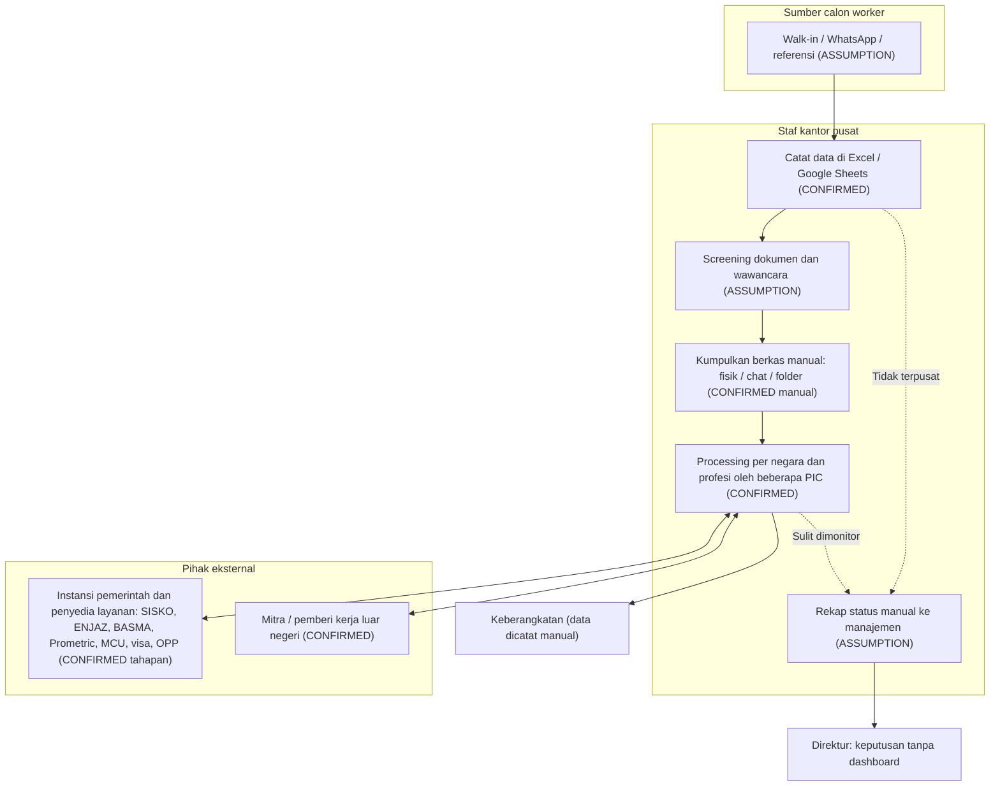
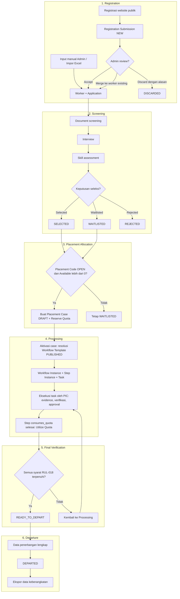
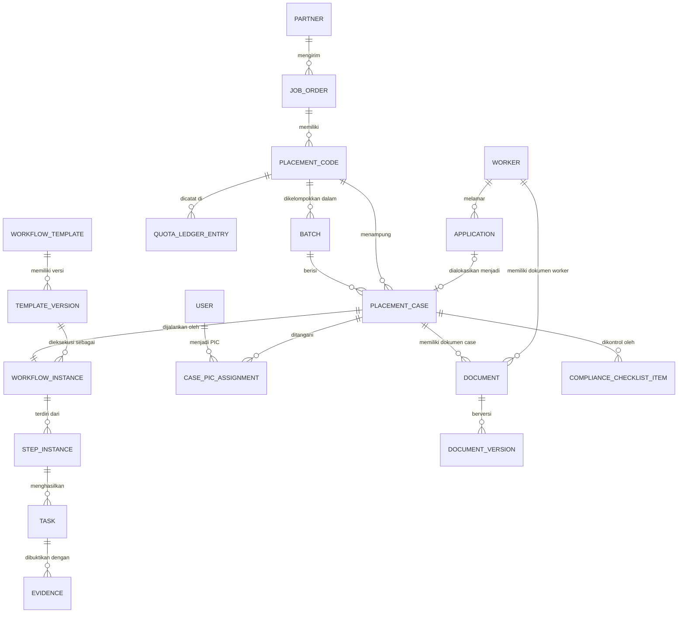

# BGS Workforce Management System — Business Requirement Document (BRD)

> **"One Worker. One Record. One Controlled Process."**

Dokumen 01 dari 04 dalam paket product discovery BGS Workforce Management System (`01-BRD`, `02-PRD`, `03-User Flow`, `04-UI/UX Blueprint`). BRD ini menjawab pertanyaan **mengapa** dan **apa** (kebutuhan bisnis); spesifikasi fungsional dirinci di `02-PRD`.

**Legenda label validasi (dipakai inline di seluruh dokumen):**

| Label | Arti |
|---|---|
| **[CONFIRMED]** | Fakta dari interview/brief owner |
| **[ASSUMPTION A-xx]** | Asumsi kerja yang belum divalidasi owner (daftar lengkap di §21) |
| **[RECOMMENDATION]** | Rekomendasi tim product, belum menjadi keputusan owner |
| **[OPEN QUESTION OQ-xx]** | Pertanyaan terbuka untuk owner (daftar lengkap di §22) |

---

## 1. Document Information

### 1.1 Metadata Dokumen

| Atribut | Isi |
|---|---|
| Nama dokumen | BGS Workforce Management System — Business Requirement Document (BRD) |
| Nomor dokumen | 01 (dari 04) |
| Versi | 0.1 (Draft untuk review owner) |
| Tanggal | 5 November 2026 |
| Penyusun | Tim Product (Ghostex / Claude) |
| Status | Draft — menunggu validasi owner |
| Pemilik bisnis | Muhamad Rizal, Direktur PT Berkah Guna Selaras |
| Klasifikasi | Internal — Rahasia perusahaan |
| Dokumen terkait | `02-BGS-Product-Requirement-Document.md`, `03-BGS-User-Flow.md`, `04-BGS-UI-UX-Blueprint.md`, `00-README-Product-Documentation.md` |
| Rantai traceability | `BR-xxx → FR-MOD-xxx → UF-xx → PG-MOD-xx` |

### 1.2 Tujuan dan Audiens Dokumen

BRD ini merumuskan kebutuhan bisnis, aturan bisnis, ruang lingkup, risiko, dan kriteria penerimaan bisnis untuk sistem manajemen workforce internal BGS. Dokumen menjadi dasar persetujuan owner sebelum PRD diturunkan menjadi backlog pengembangan.

### 1.3 Riwayat Revisi

| Versi | Tanggal | Penyusun | Perubahan |
|---|---|---|---|
| 0.1 | 5 November 2026 | Tim Product (Ghostex / Claude) | Draft awal BRD. Merekonsiliasi PRD draft v0.1 (`docs/prd-workflow-utama.html`) dengan brief master; brief master menang bila berbeda (lihat Lampiran B). |

### 1.4 Daftar Pembaca dan Approver

| Peran dalam dokumen | Pihak | Kebutuhan terhadap dokumen | Status persetujuan |
|---|---|---|---|
| Approver utama | Muhamad Rizal (Direktur BGS) | Validasi kebutuhan bisnis, scope, prioritas MVP, jawaban OQ | Belum — menunggu review |
| Reviewer operasional | Perwakilan Admin & PIC BGS (nama perlu ditetapkan owner) | Validasi as-is, tahapan processing, aturan bisnis | Belum |
| Reviewer kepatuhan | Penanggung jawab kepatuhan / konsultan hukum (perlu ditunjuk owner) | Verifikasi legal §17 | Belum |
| Pembaca teknis | Tim pengembang & arsitek | Kebutuhan untuk PRD/arsitektur | Informatif |
| Pembaca | Tim Product | Pemelihara dokumen | — |

> **Disclaimer.** Dokumen ini bukan nasihat hukum. Seluruh rujukan regulasi berstatus **perlu verifikasi legal/kepatuhan** sebelum dijadikan aturan sistem. Checklist compliance di dalam sistem adalah alat kontrol internal, bukan bukti pemenuhan persyaratan resmi (RUL-024).

---

## 2. Executive Summary

PT Berkah Guna Selaras (BGS) adalah Perusahaan Penempatan Pekerja Migran Indonesia (P3MI) berkantor pusat di Jakarta Timur yang saat ini mengelola 500–1.000 worker menggunakan Excel dan Google Sheets **[CONFIRMED]**. Pola kerja ini menimbulkan tujuh masalah inti: data tidak terpusat; recruitment dan penempatan sulit dimonitor; koordinasi dokumen manual; tanggung jawab PIC tidak terintegrasi; manajemen tidak punya dashboard; kontrol persyaratan regulasi PMI lemah; dan proses yang berbeda per negara serta profesi tidak terkelola secara sistematis **[CONFIRMED]**.

**BGS Workforce Management System** adalah aplikasi internal untuk mengelola siklus penempatan end-to-end: *Registration → Screening → Placement Allocation → Processing → Final Verification → Departure*. Sistem dirancang di atas tiga prinsip:

1. **One Worker** — satu individu memiliki satu Worker ID permanen (RUL-001) dengan banyak Application bila melamar ke beberapa negara/profesi (BR-001, BR-005).
2. **One Record** — seluruh data, dokumen, riwayat, dan PIC worker dapat dilihat dalam satu Profil 360° (BR-032).
3. **One Controlled Process** — proses processing dikonfigurasi per Negara + Profesi (+ Route/Job Order) oleh Superadmin, dieksekusi Admin dan PIC dengan verifikasi/approval, kuota yang tidak pernah terlampaui, dan final verification sebelum keberangkatan (BR-012, BR-014, BR-019, BR-021).

Lingkup dibagi tiga MVP: **MVP 1** (Foundation & Recruitment: database worker terpusat), **MVP 2** (Processing & Operations: proses operasional terkontrol), **MVP 3** (Intelligence & Automation). Calon worker bukan pengguna sistem; mereka hanya mengisi registrasi di website publik. Tidak ada integrasi API dengan sistem pemerintah; seluruh nomor referensi eksternal dicatat manual (A-08, BR-033).

Dokumen ini memuat 35 Business Requirement (BR-001–BR-035), 30 Business Rule (RUL-001–RUL-030), 22 asumsi, 25 pertanyaan terbuka untuk owner, analisis risiko, KPI usulan, dan kriteria penerimaan bisnis per MVP. Keputusan paling mendesak dari owner: OQ-01, OQ-02, OQ-03, OQ-04, OQ-05, OQ-10, OQ-11, OQ-17 (lihat §22).

---

## 3. Company Background

### 3.1 Profil Perusahaan

| Atribut | Isi | Status |
|---|---|---|
| Nama | PT Berkah Guna Selaras (BGS) | **[CONFIRMED]** |
| Jenis usaha | Perusahaan Penempatan Pekerja Migran Indonesia (P3MI) | **[CONFIRMED]** |
| Direktur | Muhamad Rizal | **[CONFIRMED]** |
| Alamat | Jl. Bekasi Timur XI No. 17/12, Rawa Bunga, Jatinegara, Jakarta Timur | **[CONFIRMED]** data awal owner; verifikasi sebelum publikasi **[OPEN QUESTION OQ-01]** |
| Telepon | 021-8584577 | idem |
| WhatsApp | +6285280944939 / +6285177823970 | idem |
| Email | berkahguna.selaras@yahoo.com | idem |
| Nomor izin P3MI / SIP3MI | Belum diterima tim product | **[OPEN QUESTION OQ-01]** |
| Kantor | Satu kantor pusat | **[CONFIRMED]**; implikasi: tidak ada data scope per cabang di MVP **[ASSUMPTION A-02]** |
| Skala operasional | 500–1.000 worker | **[CONFIRMED]** |
| Negara tujuan | Arab Saudi, Dubai/UEA, Jepang, Korea Selatan, Taiwan | **[CONFIRMED]**; jalur penempatan aktual per negara **[OPEN QUESTION OQ-02]** |
| Kategori pekerjaan | Formal dan informal | **[CONFIRMED]** |
| Perangkat kerja saat ini | Excel dan Google Sheets | **[CONFIRMED]** |

### 3.2 Catatan Konteks Negara Tujuan

Draft v0.1 mencatat bahwa penempatan ke Korea Selatan (skema EPS) umumnya berjalan melalui jalur pemerintah (G-to-G), bukan P3MI. Apakah BGS menjalankan jalur tersebut, atau skema lain, belum terkonfirmasi **[OPEN QUESTION OQ-02]**. Sistem dirancang agar negara, profesi, dan jalur penempatan adalah master data yang dapat diatur, sehingga tidak ada kombinasi yang di-hardcode.

---

## 4. Business Overview

### 4.1 Model Bisnis Penempatan (Gambaran Konseptual)

BGS menghubungkan **calon pekerja migran** dengan **mitra usaha/pemberi kerja/agensi di luar negeri** dalam kerangka penempatan yang diatur pemerintah. Rantai nilai konseptual:

| Tahap | Aktivitas bisnis | Output utama |
|---|---|---|
| Rekrutmen | Calon worker mendaftar (website atau Admin), BGS menyaring | Worker + Application terseleksi |
| Permintaan tenaga kerja | Partner mengirim permintaan (Job Order/demand letter) | Job Order, Placement Code, Quota |
| Penempatan | Application terseleksi dialokasikan ke Placement Code | Placement Case |
| Pengurusan | Dokumen, biometrik, MCU, visa, OPP, dan tahapan lain sesuai negara/profesi | Dokumen & referensi eksternal lengkap |
| Verifikasi akhir & keberangkatan | Pemeriksaan kesiapan, jadwal penerbangan | Worker berangkat, data keberangkatan |

Tahapan processing yang disebut dalam interview (Pendaftaran SISKO, Biometrik, Prometric, ENJAZ, BASMA, Apostille, Medical Check Up, Persiapan Visa, OPP) **bukan daftar resmi universal**; tidak semua berlaku untuk setiap negara/profesi dan seluruhnya harus dapat dikonfigurasi lewat Workflow Template **[CONFIRMED]**. Urutan resmi per negara/profesi **[OPEN QUESTION OQ-03]**.

### 4.2 Ruang Lingkup Produk dalam Satu Kalimat

Aplikasi internal web untuk 5 role (Superadmin, Director, Admin, PIC, Viewer) plus satu website registrasi publik untuk calon worker, yang mengelola data worker, rekrutmen, dokumen, alokasi dan kuota penempatan, workflow processing, task PIC, compliance checklist internal, serta dashboard dan laporan.

### 4.3 Prinsip Desain Bisnis

| # | Prinsip | Turunan |
|---|---|---|
| P-1 | Satu individu, satu identitas | RUL-001, RUL-002, FR-WRK-006 |
| P-2 | Pisahkan identitas, lamaran, dan proses penempatan (Worker ≠ Application ≠ Placement Case) | §13.3 |
| P-3 | Kuota dikendalikan di titik alokasi, bukan registrasi | RUL-004, RUL-005 |
| P-4 | Proses dikonfigurasi, bukan di-hardcode | BR-014, RUL-013 |
| P-5 | Akuntabilitas: satu Case Owner, banyak PIC | RUL-019 |
| P-6 | Maker-checker pada langkah kritis | RUL-016, BR-019 |
| P-7 | Minimisasi dan perlindungan data pribadi | BR-009, BR-030 |
| P-8 | Tidak mengasumsikan integrasi pemerintah | A-08, BR-033 |

---

## 5. Current Business Process (As-Is)

### 5.1 Gambaran Proses Saat Ini

Proses as-is berikut disusun dari brief owner. Tingkat detail langkah operasional (siapa mengisi spreadsheet mana, kapan) **belum diobservasi langsung**; bagian bertanda ASSUMPTION perlu divalidasi lewat sesi observasi dengan Admin dan PIC.

| Langkah as-is | Deskripsi | Status |
|---|---|---|
| Pencatatan worker | Data worker dicatat di Excel/Google Sheets | **[CONFIRMED]** |
| Pendaftaran | Calon worker mendaftar secara langsung/perantara; belum ada website registrasi terpusat | **[ASSUMPTION A-10]** (pola walk-in/WhatsApp/referensi dari BR-003) |
| Screening | Pemeriksaan dokumen dan wawancara dicatat di spreadsheet | **[ASSUMPTION A-10]** |
| Dokumen | Berkas dikumpulkan dan dikoordinasikan manual (fisik/WhatsApp/folder) | **[CONFIRMED]** masalah koordinasi dokumen manual; media penyimpanan **[ASSUMPTION A-10]** |
| Processing | Pengurusan SISKO, biometrik, Prometric, ENJAZ, BASMA, Apostille, MCU, visa, OPP dilakukan staf; berbeda per negara/profesi | **[CONFIRMED]** tahapan dari interview; urutan **[OPEN QUESTION OQ-03]** |
| Pembagian tugas | PIC menangani worker; tanggung jawab tidak terintegrasi dan satu worker dapat ditangani banyak PIC | **[CONFIRMED]** |
| Pelaporan ke manajemen | Rekap manual dari spreadsheet; tidak ada dashboard | **[CONFIRMED]** kebutuhan dashboard; mekanisme rekap **[ASSUMPTION A-10]** |
| Keberangkatan | Jadwal dan data berangkat dicatat manual | **[ASSUMPTION A-10]** |

### 5.2 Diagram As-Is

### 5.3 Karakteristik As-Is yang Relevan

- Banyak sumber kebenaran: potensi satu orang tercatat ganda di beberapa sheet (duplikasi); tidak ada Worker ID permanen **[ASSUMPTION A-10]**.
- Kuota penempatan tidak dilacak dalam pemisahan Total/Reserved/Utilized — pemisahan ini adalah **[CONFIRMED]** kebutuhan desain; cara pelacakan saat ini **[OPEN QUESTION OQ-05]**.
- Tidak ada jejak audit siapa mengubah apa (inherent pada spreadsheet bersama) **[ASSUMPTION A-10]**.
- Cutover harus memperhitungkan kualitas data Excel yang belum dinilai **[OPEN QUESTION OQ-17]**.

---

## 6. Current Business Problems

Tujuh masalah berikut **[CONFIRMED]** dari brief owner. Kolom dampak bisnis adalah analisis tim product **[RECOMMENDATION]** dan perlu divalidasi dengan angka nyata (baseline, §20).

| ID | Masalah | Dampak bisnis | BR yang menjawab |
|---|---|---|---|
| P1 | Data pekerja belum terpusat | Duplikasi dan data tidak sinkron; waktu pencarian tinggi; risiko kehilangan data saat staf berganti; tidak ada riwayat 360° | BR-001, BR-002, BR-003, BR-004, BR-005, BR-008, BR-010, BR-032 |
| P2 | Recruitment dan penempatan sulit dimonitor | Tidak tahu posisi worker di funnel; kuota job order bisa salah alokasi; tidak ada alasan seleksi terdokumentasi | BR-006, BR-007, BR-011, BR-012, BR-013, BR-016, BR-020, BR-022, BR-031 |
| P3 | Koordinasi dokumen manual | Dokumen hilang/kedaluwarsa tak terpantau; verifikasi tidak terlacak; berkas sensitif tersebar | BR-008, BR-009, BR-018, BR-029, BR-033 |
| P4 | Tanggung jawab PIC tidak terintegrasi | Tidak jelas siapa bertanggung jawab per tahap; tugas tertukar atau terlewat; beban kerja tak terlihat | BR-017, BR-018, BR-019, BR-020, BR-027, BR-031 |
| P5 | Manajemen membutuhkan dashboard | Keputusan berbasis laporan manual yang terlambat; tidak ada visibilitas pipeline, overdue, kuota | BR-025, BR-026, BR-031, BR-034 |
| P6 | Perlu kontrol persyaratan regulasi PMI | Risiko berangkat dengan persyaratan tidak lengkap; temuan saat inspeksi/pelaporan; perubahan regulasi tak terkelola | BR-021, BR-023, BR-024, BR-028, BR-030, BR-035 |
| P7 | Kebutuhan proses berbeda per negara dan profesi | Prosedur bergantung pada ingatan staf; sulit mengajarkan staf baru; perubahan alur mengganggu proses berjalan | BR-014, BR-015, BR-016, BR-021, BR-023 |

> Pemetaan BR→masalah ini dipakai sebagai kolom "Sumber masalah" pada §14.

---

## 7. Business Objectives

Sembilan objektif berikut berasal dari brief **[CONFIRMED]**. Ukuran keberhasilan adalah **target usulan [RECOMMENDATION]**; baseline belum diukur dan harus ditetapkan sebelum target difinalkan (lihat §20 untuk daftar KPI).

| ID | Objektif bisnis | Ukuran keberhasilan (usulan) | BR terkait | KPI (§20) |
|---|---|---|---|---|
| OBJ-1 | Digitalisasi seluruh administrasi worker | 100% worker aktif tercatat di sistem pada akhir cutover MVP 1 | BR-001–BR-004, BR-008 | KPI-01, KPI-02 |
| OBJ-2 | Membangun centralized worker database | 0 duplikasi NIK aktif; 1 Worker ID per individu | BR-001, BR-005, BR-032 | KPI-02, KPI-03 |
| OBJ-3 | Mengotomatisasi workflow berdasarkan negara dan profesi | 100% Placement Case berjalan di bawah Workflow Template ber-versi | BR-014–BR-016 | KPI-08 |
| OBJ-4 | Mengontrol tugas dan tanggung jawab setiap PIC | 100% task punya pemilik & tenggat; on-time rate terukur per PIC | BR-017–BR-020, BR-031 | KPI-09, KPI-10 |
| OBJ-5 | Memantau kuota dan alokasi penempatan | 0 kejadian Available < 0; utilisasi kuota terlihat real-time | BR-011–BR-013 | KPI-11 |
| OBJ-6 | Memastikan kelengkapan dokumen dan persyaratan | Persentase case lolos final verification tanpa temuan kekurangan dokumen meningkat dari baseline | BR-008, BR-021, BR-023, BR-024 | KPI-06, KPI-12 |
| OBJ-7 | Menyediakan executive dashboard | Direktur dapat melihat pipeline, overdue, kuota tanpa rekap manual; waktu penyusunan laporan bulanan turun dari baseline | BR-025, BR-026 | KPI-13 |
| OBJ-8 | Meningkatkan efisiensi dan akuntabilitas operasional | Durasi registrasi→berangkat turun dari baseline; 100% perubahan penting punya jejak audit | BR-016–BR-020, BR-028 | KPI-07, KPI-14 |
| OBJ-9 | Mendukung kepatuhan terhadap regulasi pemerintah | 100% case punya compliance checklist; referensi regulasi terversi | BR-023, BR-024, BR-030 | KPI-12, KPI-15 |

> ID OBJ-n dan KPI-nn adalah penomoran lokal di dokumen ini untuk keterbacaan, bukan ID kontrak lintas dokumen.

---

## 8. Product Vision

**Nama produk:** BGS Workforce Management System. **Tagline:** *"One Worker. One Record. One Controlled Process."* **[CONFIRMED]**

**Vision statement:** Membangun platform terintegrasi untuk mengelola seluruh siklus penempatan Pekerja Migran Indonesia — mulai dari pendaftaran, screening, pengurusan dokumen, processing, hingga keberangkatan **[CONFIRMED]**.

### 8.1 Arah Tiga Fase

| Fase | Tujuan | Nilai bagi bisnis |
|---|---|---|
| MVP 1 — Foundation & Recruitment | Database worker terpusat | Satu sumber kebenaran data dan dokumen worker; recruitment terstruktur |
| MVP 2 — Processing & Operations | Seluruh proses operasional penempatan terkontrol | Workflow per negara+profesi, kuota aman, PIC akuntabel, final verification |
| MVP 3 — Intelligence & Automation | Efisiensi dan keputusan lebih baik | Analitik lanjutan, notifikasi otomatis, asisten AI dengan human-in-the-loop, retensi PDP |

### 8.2 Arah Jangka Panjang (Future, di luar MVP 3)

Portal worker, notifikasi WhatsApp, pemantauan pasca-keberangkatan, modul keuangan, tanda tangan elektronik, multi-cabang, aplikasi mobile. Setiap item bergantung pada jawaban OQ-12, OQ-13, OQ-19, OQ-20, OQ-23 dan keputusan owner.

---

## 9. Business Scope

Cakupan per modul, dipetakan ke MVP (sesuai strategi MVP kontrak; fitur tidak dipindah ke MVP lebih awal).

| Modul | Cakupan bisnis | MVP | BR utama |
|---|---|---|---|
| M01 Dashboard | Dashboard per role: dasar (MVP 1), executive/PIC/pipeline/kuota (MVP 2), analitik lanjutan & KPI (MVP 3) | 1 / 2 / 3 | BR-025 |
| M02 Worker Management (termasuk Public Registration & Import) | Database worker, Worker ID, profil, registrasi publik, input manual, dedup/merge, impor Excel, Profil 360° | 1 | BR-001–BR-005, BR-032 |
| M03 Recruitment | Application, screening dokumen, interview, skill assessment, keputusan seleksi, penolakan | 1 | BR-005–BR-007 |
| M04 Document | Document type, upload, verifikasi, versi, masa berlaku, kontrol akses, penyimpanan aman; paket dokumen per case (MVP 2) | 1 (paket: 2) | BR-008, BR-009 |
| M05 Workflow | Template builder, step, dependensi, due date rule, versioning, publish, migrasi terkontrol | 2 | BR-014, BR-015 |
| M06 Processing | Placement allocation, Placement Case, eksekusi workflow, blocked/overdue, final verification, departure | 2 | BR-013, BR-016, BR-020–BR-022, BR-033 |
| M07 PIC & Task | PIC Role, multi-PIC, task, evidence, verifikasi, approval, segregation of duties | 2 | BR-017–BR-019, BR-031 |
| M08 Placement & Quota | Country/Profession/Route (MVP 1), Partner/Job Order/Placement Code/Batch/Quota (MVP 2) | 1 / 2 | BR-010–BR-012 |
| M09 Compliance | Requirement set dokumen (MVP 1), requirement rule berversi, checklist per case, regulatory reference (MVP 2), monitoring lanjutan (MVP 3) | 1 / 2 / 3 | BR-023, BR-024 |
| M10 User & Access | Autentikasi, 2FA, role, permission, data scope, audit trail, log akses sensitif | 1 (otoritas approval: 2) | BR-027, BR-028 |
| M11 Reports | Laporan worker & recruitment + mesin ekspor (MVP 1); processing/quota/departure/compliance (MVP 2); lanjutan (MVP 3) | 1 / 2 / 3 | BR-026 |
| M12 Notification | Notifikasi in-app (MVP 2), reminder/overdue/expiry otomatis (MVP 3) | 2 / 3 | BR-029 |
| Public Registration | Website registrasi publik multi-step mobile-first, consent PDP | 1 | BR-002, BR-030 |
| Lintas: Data Protection | Consent (MVP 1), permintaan subjek data (MVP 2), retensi (MVP 3) | 1 / 2 / 3 | BR-030 |
| MVP 3: AI Assistant & Integrasi | Asisten AI dokumen/operasional; integrasi hanya bila akses resmi tersedia | 3 / Future | BR-034, BR-035 |

### 9.1 Lingkup Per MVP

| MVP | Tujuan | Isi | BR yang dipenuhi |
|---|---|---|---|
| **MVP 1** Foundation & Recruitment | Database worker terpusat | Authentication, Role & Permission, Master Data (Country, Profession, Route, Document Type), Worker Management, Public Registration, Manual Input, Recruitment, Screening, Interview, Document Management (termasuk verifikasi dasar dokumen untuk screening), Worker Profile, Basic Dashboard, Data Import Excel, ekspor dasar, audit trail, consent PDP | BR-001–BR-010, BR-025 (dasar), BR-026 (dasar), BR-027, BR-028, BR-030 (consent), BR-032 |
| **MVP 2** Processing & Operations | Seluruh proses operasional terkontrol | Workflow Template Builder, Versioning, Execution, PIC Assignment, Task Management, verifikasi task & dokumen di workflow, Approval, Partner/Job Order/Placement Code/Batch, Quota, Processing Dashboard, Compliance Checklist, Final Verification, Departure, notifikasi in-app dasar | BR-010 (Partner), BR-011–BR-024, BR-025, BR-026, BR-029 (dasar), BR-030, BR-031 (dasar), BR-033 |
| **MVP 3** Intelligence & Automation | Efisiensi dan pengambilan keputusan | Advanced Dashboard, Advanced Reporting, Bottleneck Monitoring, Automated Notifications, Advanced Compliance Monitoring, AI Document Assistant, AI Operational Assistant, External Integrations jika tersedia, retensi PDP | BR-025 (lanjutan), BR-026 (lanjutan), BR-029 (otomatis), BR-030, BR-031, BR-034, BR-035 |

---

## 10. Out of Scope

| # | Item di luar scope | Alasan | Referensi / jalur lanjut |
|---|---|---|---|
| 1 | Pemantauan pasca-keberangkatan, kepulangan, perpanjangan kontrak (kecuali ekspor data keberangkatan) | Brief membatasi MVP pada siklus hingga Departure; kewajiban pelaporan pasca-berangkat perlu verifikasi legal | **[ASSUMPTION A-19]**, **[OPEN QUESTION OQ-19]**, Future Roadmap |
| 2 | Biaya penempatan, keuangan, payroll, invoicing | Bukan bagian kebutuhan terkonfirmasi; domain risiko dan kompleksitas berbeda | **[ASSUMPTION A-20]**, **[OPEN QUESTION OQ-20]** |
| 3 | Portal/login untuk calon worker (cek status mandiri) | Brief: calon worker bukan pengguna internal; komunikasi status manual lewat WhatsApp/telepon | **[ASSUMPTION A-03]**, **[OPEN QUESTION OQ-12]** |
| 4 | Integrasi API dengan Sisko P2MI/SISKO, ENJAZ, BASMA, Prometric, imigrasi, klinik | Akses API resmi tidak terkonfirmasi; output dicatat manual sebagai nomor referensi + file bukti | **[ASSUMPTION A-08]**, BR-033, BR-035 |
| 5 | Pengiriman notifikasi WhatsApp/SMS ke worker | Ketersediaan WhatsApp Business API dan kebijakan belum diputuskan | **[OPEN QUESTION OQ-13]** |
| 6 | Tanda tangan elektronik | Tanda tangan tetap basah; sistem menyimpan scan | **[ASSUMPTION A-22]**, **[OPEN QUESTION OQ-23]** |
| 7 | Multi-cabang / data scope per office | Satu kantor pusat | **[ASSUMPTION A-02]** |
| 8 | Aplikasi mobile native | Web responsif (mobile-friendly untuk PIC dan registrasi publik) cukup untuk MVP | Future |
| 9 | Penetapan keputusan legal atas regulasi / pembuatan "bukti resmi" kepatuhan | Compliance checklist hanya alat kontrol internal | RUL-024, §17 |
| 10 | Pencatatan kontrak dan hubungan hukum dengan Partner di luar nomor referensi dan dokumen terkait Job Order | Sistem bukan contract management | [RECOMMENDATION] |
| 11 | Pengelolaan pelatihan/BLK dan akomodasi penampungan | Tidak disebut dalam brief; bila perlu, dimodelkan sebagai step di template | [RECOMMENDATION] |
| 12 | Hard delete data dan retensi otomatis sebelum kebijakan ditetapkan | Belum ada kebijakan retensi | **[ASSUMPTION A-21]**, **[OPEN QUESTION OQ-15]**, FR-PDP-003 (MVP 3) |

---

## 11. Stakeholder Analysis

### 11.1 Daftar Stakeholder

| Kelompok | Stakeholder | Kepentingan | Pengaruh | Kebutuhan utama terhadap sistem |
|---|---|---|---|---|
| Internal | Direktur / Pemilik (Muhamad Rizal) | Visibilitas pipeline, kuota, risiko; keputusan strategis | Tinggi | Executive dashboard ringkas, approval proses strategis, laporan (BR-025, BR-026, BR-019) |
| Internal | Superadmin (penanggung jawab sistem) | Konfigurasi sistem, keamanan, template | Tinggi | Kelola user/role/scope, template, rule, master data (BR-014, BR-027) |
| Internal | Admin operasional | Input volume tinggi, koordinasi, alokasi, final verification | Tinggi (pengguna harian) | Registration inbox, impor, alokasi, Job Order, kuota (BR-002–BR-004, BR-013) |
| Internal | PIC (pelaksana per tahap) | Tugas jelas, bukti mudah diunggah, tidak tumpang tindih | Menengah | My Tasks, evidence, mobile-friendly (BR-017, BR-018) |
| Internal | Viewer (pemantau) | Melihat data read-only sesuai scope | Rendah | Dashboard dan laporan terbatas; identitas Viewer **[OPEN QUESTION OQ-18]** |
| Calon worker | Calon worker / CPMI (non-user) | Pendaftaran mudah, data pribadi aman, informasi status | Rendah dalam sistem, tinggi pada kualitas data | Form registrasi mobile-first, consent jelas (BR-002, BR-030); status via komunikasi manual **[ASSUMPTION A-03]** |
| Calon worker | Keluarga / perantara pendaftaran | Perantara informasi | Rendah | Tidak memiliki akses; data dicatat Admin |
| Mitra | Partner / pemberi kerja / agensi luar negeri | Pemenuhan Job Order tepat jumlah, kualitas, waktu | Tinggi (sumber demand) | Tidak menjadi pengguna; Job Order dan kuota akurat (BR-011, BR-012) |
| Pemerintah | Kementerian/Badan penyelenggara pelindungan PMI (P2MI/BP2MI) | Kepatuhan P3MI, pelaporan | Tinggi (regulator) | Tidak menjadi pengguna; data dan laporan keberangkatan siap ekspor (BR-022); format **[OPEN QUESTION OQ-14]** |
| Pemerintah | Instansi layanan lain (imigrasi, kesehatan/MCU, apostille) dan sistem seperti SISKO/ENJAZ/BASMA | Proses dilakukan manual oleh staf BGS | Tinggi pada durasi proses | Hanya nomor referensi + bukti dicatat manual (BR-033, A-08) |
| Pemerintah | Otoritas pelindungan data pribadi | Kepatuhan UU PDP | Tinggi (regulator) | Consent, minimisasi, hak subjek data, retensi (BR-030) |
| Penyedia | Pengelola infrastruktur / hosting | Operasional server, backup | Menengah | Ditentukan owner **[OPEN QUESTION OQ-16]** |
| Penyedia | Konsultan hukum/kepatuhan (perlu ditunjuk) | Verifikasi legal regulasi | Menengah | Referensi regulasi berstatus verifikasi (BR-023) |

### 11.2 Matriks Kepentingan–Pengaruh

| | Pengaruh rendah | Pengaruh menengah | Pengaruh tinggi |
|---|---|---|---|
| **Kepentingan tinggi** | Calon worker | PIC | Direktur, Superadmin, Admin |
| **Kepentingan menengah** | Viewer, keluarga/perantara | Pengelola hosting, konsultan kepatuhan | Partner, otoritas PDP |
| **Kepentingan rendah/tidak langsung** | — | — | Instansi pemerintah pelaksana layanan (interaksi manual) |

### 11.3 Strategi Pelibatan **[RECOMMENDATION]**

| Stakeholder | Strategi |
|---|---|
| Direktur | Review BRD/PRD, jawab OQ prioritas, sign-off BAC per MVP |
| Admin & PIC | Observasi as-is, validasi tahapan dan aturan, UAT per MVP, pelatihan sebelum cutover |
| Superadmin | Terlibat sejak desain template; pemilik konfigurasi |
| Konsultan hukum | Verifikasi §17 sebelum rule dijadikan ACTIVE |
| Calon worker | Uji usability form registrasi pada perangkat seluler beragam |

---

## 12. User & Role Analysis

### 12.1 Role Internal

Lima role baseline **[CONFIRMED]**. Satu user boleh memiliki lebih dari satu role **[ASSUMPTION A-04]**; Superadmin dapat membuat custom role **[RECOMMENDATION]**. Estimasi 10–30 akun, concurrent ≤ 30 **[ASSUMPTION A-01]**.

| Role | Tanggung jawab bisnis | Data scope default | Catatan |
|---|---|---|---|
| **Superadmin** (PS-01) | Konfigurasi sistem, user/role/permission/scope, master data, Workflow Template (satu-satunya yang membuat & publish — RUL-013), requirement rule, ubah Total Quota (dengan alasan + referensi) | ALL | Tetap terikat segregation of duties (RUL-016) |
| **Director** (PS-02) | Pemantauan eksekutif; approval proses strategis (migrasi workflow, perubahan Total Quota, REVERT quota/cancel setelah utilized, waiver — default tidak boleh, merge duplikat bila diwajibkan) | ALL (read) | Daftar proses strategis **[ASSUMPTION A-15b]**, **[OPEN QUESTION OQ-08]** |
| **Admin** (PS-03) | Registration inbox, input worker, impor, application, screening, keputusan seleksi, alokasi, Job Order/Placement Code/Batch, assign PIC, eksekusi/verifikasi task, final verification, departure | ALL **[ASSUMPTION A-04b]** | Final verification dilakukan Admin **[ASSUMPTION A-15]** |
| **PIC** (PS-04) | Eksekusi task pada case yang di-assign, upload evidence, verifikasi bila ditetapkan, PIC Keberangkatan mencatat departure | ASSIGNED | Hanya dokumen relevan tugasnya (RUL-020); aktivitas fisik worker dicatat PIC **[ASSUMPTION A-13]** |
| **Viewer** (PS-05) | Pemantauan read-only | Dikonfigurasi (default COUNTRY atau ALL tanpa reveal) | Tidak melihat file RESTRICTED secara default; identitas role **[OPEN QUESTION OQ-18]** |

### 12.2 Kapabilitas Ringkas per Role

| Kapabilitas | Superadmin | Director | Admin | PIC | Viewer |
|---|---|---|---|---|---|
| Kelola user, role, permission, data scope | ✓ | – | – | – | – |
| Master data | ✓ | lihat | lihat (usul) | – | lihat |
| Partner, Job Order, Placement Code, Batch | ✓ | lihat | ✓ kelola | lihat (terkait) | lihat |
| Ubah Total Quota | ✓ | approve | ajukan | – | – |
| Workflow template (buat, publish, versi, migrasi) | ✓ | approve migrasi | lihat | – | – |
| Registration inbox, input worker, impor | ✓ | – | ✓ | – | – |
| Application & screening | ✓ | lihat | ✓ | ✓ (assigned) | lihat |
| Buat Placement Case (alokasi) | ✓ | – | ✓ | – | – |
| Assign / reassign PIC | ✓ | – | ✓ | – | – |
| Eksekusi task | ✓ | – | ✓ | ✓ (miliknya) | – |
| Verifikasi / approval | ✓ | ✓ (strategis) | ✓ bila ditetapkan | ✓ verifikasi bila ditetapkan | – |
| Final verification | ✓ | approve bila dikonfigurasi | ✓ | – | – |
| Audit log | ✓ | lihat | – | – | – |

Matriks granular per permission ada di `02-PRD §14`. Data sensitif: dokumen dikelompokkan INTERNAL / CONFIDENTIAL / RESTRICTED (paspor, KK, hasil medis/psikologi); akses RESTRICTED butuh permission khusus dan tercatat (RUL-020, RUL-021).

### 12.3 Calon Worker (Non-User)

| Aspek | Penjelasan |
|---|---|
| Peran | Subjek data dan pengguna website registrasi publik (PS-06); **tidak** memiliki akun login **[CONFIRMED]** |
| Interaksi sistem | Mengisi form registrasi (data minimum + pas foto & CV opsional **[ASSUMPTION A-11]**), memberikan consent (RUL-029) |
| Komunikasi status | Manual via WhatsApp/telepon oleh Admin/PIC **[ASSUMPTION A-03]** |
| Perlindungan | Hak subjek data (akses, koreksi, penghapusan) dicatat sebagai permintaan (FR-PDP-002) |
| Konteks pengguna | Mobile-first, koneksi terbatas, literasi digital beragam **[ASSUMPTION — PS-06]** |

---

## 13. Business Process Overview (To-Be)

### 13.1 Alur End-to-End

### 13.2 Ringkasan Tahap, Pemilik, dan Status

| Tahap | Pelaku utama | Status entitas hasil | BR / RUL |
|---|---|---|---|
| Registration | Calon worker, Admin | Registration Submission `NEW` → `ACCEPTED`/`MERGED`/`DISCARDED`; Worker `ACTIVE`; Application `SUBMITTED` | BR-002–BR-005; RUL-001–RUL-004 |
| Screening | Admin, PIC screening | Application `SCREENING`, `REVISION_REQUIRED`, `INTERVIEW`, `ASSESSMENT`, `SELECTED`/`WAITLISTED`/`REJECTED` | BR-006, BR-007 |
| Placement Allocation | Admin | Application `ALLOCATED`; Placement Case `DRAFT`; Quota Reserved | BR-011–BR-013; RUL-005, RUL-010 |
| Processing | Admin, PIC, Director (approval strategis) | Placement Case `IN_PROCESS`; Step Instance `LOCKED`→`COMPLETED`; Task 9 status | BR-014–BR-020, BR-033; RUL-011–RUL-017 |
| Final Verification | Admin (Director approve bila dikonfigurasi) | Placement Case `FINAL_VERIFICATION` → `READY_TO_DEPART` | BR-021, BR-024; RUL-018 |
| Departure | Admin, PIC Keberangkatan | Placement Case `DEPARTED`; Worker `DEPLOYED` | BR-022; RUL-030 |

Status ON_HOLD, CANCELLED, WITHDRAWN dapat terjadi pada titik tertentu dengan alasan wajib (RUL-022). Model status lengkap ada di `02-PRD`.

### 13.3 Tiga Entitas Inti: Worker, Application, Placement Case

| Entitas | Definisi | Kunci identitas | Siklus hidup |
|---|---|---|---|
| **Worker** | Identitas individu; satu Worker ID permanen (RUL-001, format `BGS-W-{YYYY}-{NNNNN}` **[ASSUMPTION A-06]**) | NIK dan paspor unik (RUL-002) | `ACTIVE` → `IN_PROCESS` → `DEPLOYED`; `INACTIVE`, `ARCHIVED` |
| **Application** | Lamaran satu worker untuk satu kombinasi Negara + Profesi (+ Route); format `APP-{YYYY}-{NNNNN}` | Worker + Negara + Profesi | `SUBMITTED` → … → `SELECTED`/`WAITLISTED` → `ALLOCATED`; terminal `REJECTED`/`WITHDRAWN`/`CANCELLED` |
| **Placement Case** | Proses penempatan aktual; dibuat hanya saat alokasi; memuat Placement Code, Workflow Template Version, PIC, Quota Allocation; format `PC-{YYYY}-{NNNNN}` | Application yang dialokasikan | `DRAFT` → `IN_PROCESS` → `FINAL_VERIFICATION` → `READY_TO_DEPART` → `DEPARTED`; `ON_HOLD`, `CANCELLED` |

**Contoh: 1 worker, 2 application** *(ilustrasi, bukan data nyata)*

Siti (`BGS-W-2026-00123`) mendaftar untuk dua tujuan:

| Application | Negara + Profesi | Perjalanan | Hasil |
|---|---|---|---|
| `APP-2026-00210` | Arab Saudi + Domestic Worker | Lolos seleksi, Placement Code `SA-DMW-2612-01` OPEN dan Available ≥ 1 → Placement Case `PC-2026-00045` dibuat, quota Reserved 1 | `ALLOCATED`; Worker `IN_PROCESS` |
| `APP-2026-00211` | Taiwan + Caregiver | Lolos seleksi tetapi kuota `TW-CGV-2612-01` habis | `WAITLISTED`; tidak ada Placement Case |

Konsekuensi: Siti tetap satu Worker. Selama `PC-2026-00045` aktif, Siti tidak dapat memiliki Placement Case aktif lain (RUL-009 **[ASSUMPTION A-09]**, **[OPEN QUESTION OQ-22]**). Bila `PC-2026-00045` dibatalkan sebelum utilized, quota di-release (RUL-007) dan `APP-2026-00211` dapat dipertimbangkan Admin dari waiting list (FR-PLC-012: urutan FIFO hanya saran). Bila Siti mengundurkan diri dari Application yang sudah dialokasikan, quota Reserved dilepas.

### 13.4 Relasi Entitas Konseptual

### 13.5 Contoh Variasi Workflow per Negara + Profesi

> **[ASSUMPTION — tahapan belum resmi]** Dua contoh berikut ilustrasi untuk menunjukkan bahwa alur berbeda per Negara + Profesi. Daftar tahapan resmi dan urutannya belum dikonfirmasi owner **[OPEN QUESTION OQ-03]**, posisi SISKO **[OPEN QUESTION OQ-04]**, jalur penempatan **[OPEN QUESTION OQ-02]**. Jangan dipakai sebagai prosedur resmi.

| No | **Arab Saudi — Domestic Worker** (ilustrasi) | **Jepang — Caregiver** (ilustrasi) |
|---|---|---|
| 1 | Pendaftaran SISKO | Pendaftaran SISKO |
| 2 | Medical Check Up | Pelatihan / sertifikasi bahasa (bila diperlukan) |
| 3 | Biometrik | Medical Check Up |
| 4 | Apostille dokumen | Apostille / legalisasi dokumen |
| 5 | ENJAZ | Persiapan Visa |
| 6 | BASMA | OPP |
| 7 | Persiapan Visa | Final Verification |
| 8 | OPP | Departure |
| 9 | Final Verification → Departure | — |
| Catatan | ENJAZ dan BASMA dicatat sebagai nomor referensi + bukti manual (A-08) | Prometric tidak ada pada contoh ini; belum ada kepastian skema Jepang |

Perbedaan inilah alasan Workflow Template dikunci pada Negara + Profesi (+ Route/Job Order) dan dikelola Superadmin (BR-014, RUL-011, RUL-013). Placement Case yang berjalan mengunci versi template-nya (RUL-012).

---

## 14. Business Requirements

Kolom **Sumber masalah** merujuk P1–P7 pada §6. Prioritas memakai MoSCoW. Kolom **MVP** mengikuti strategi MVP kontrak; "1 dasar / 2 / 3 lanjutan" berarti kapabilitas bertahap. FR penurun di Lampiran A.

| ID | Business Requirement | Rasional bisnis | MoSCoW | MVP | Sumber masalah | Kriteria keberhasilan |
|---|---|---|---|---|---|---|
| BR-001 | Database worker terpusat: satu individu = satu record dengan Worker ID permanen, bebas duplikat | Menghilangkan duplikasi dan banyak sumber kebenaran | Must | 1 | P1 | 0 NIK aktif ganda; semua worker punya Worker ID |
| BR-002 | Calon worker dapat mendaftar online melalui website publik | Memperluas jangkauan dan mengurangi input ulang oleh staf | Must | 1 | P1 | Registrasi publik tersedia di perangkat seluler; masuk ke inbox Admin tanpa input ulang |
| BR-003 | Admin dapat menginput worker secara manual (walk-in / WhatsApp / referensi) | Kanal pendaftaran non-digital tetap dominan | Must | 1 | P1 | Admin dapat membuat Worker + Application lengkap dengan bukti consent |
| BR-004 | Data existing dari Excel/Google Sheets dapat dimigrasi dengan validasi | Tanpa migrasi, sistem tidak dipakai (adopsi) | Must | 1 | P1 | Impor dengan dry-run, laporan error, dan rollback per batch; seluruh worker aktif termigrasi |
| BR-005 | Satu worker dapat memiliki beberapa application untuk negara & profesi berbeda | Worker sering melamar lebih dari satu tujuan | Must | 1 | P1 | Worker dengan 2 application tampil dalam satu profil; maks satu aktif per (negara, profesi) |
| BR-006 | Screening (dokumen, interview, skill assessment) tercatat terstruktur beserta hasil & alasan | Seleksi dapat dipertanggungjawabkan | Must | 1 | P2 | Setiap application SELECTED/REJECTED punya hasil screening tercatat |
| BR-007 | Keputusan seleksi & penolakan terdokumentasi dengan alasan dan riwayat | Akuntabilitas dan kemampuan menjelaskan keputusan | Must | 1 | P2 | 100% keputusan punya alasan dan pelaku |
| BR-008 | Dokumen worker tersimpan terpusat: kategori, verifikasi, versi, masa berlaku | Mengakhiri koordinasi dokumen manual | Must | 1 | P1, P3 | Dokumen terklasifikasi, terversi, status verifikasi dan expiry terlihat |
| BR-009 | Dokumen & data sensitif (KTP, paspor, KK, kesehatan) dilindungi aksesnya | Risiko kebocoran data pribadi dan sanksi PDP | Must | 1 | P3 | Akses RESTRICTED hanya via permission dan tercatat; NIK/paspor ter-mask default |
| BR-010 | Master data negara, profesi, jalur penempatan, mitra terkelola terpusat | Fondasi konfigurasi per negara/profesi | Must | 1 (Partner: 2) | P1 | Master dapat diubah Superadmin tanpa perubahan kode |
| BR-011 | Job Order, Placement Code, dan Batch terkelola | Kuota harus melekat pada permintaan tenaga kerja nyata | Must | 2 | P2 | Setiap case terkait Placement Code ← Job Order ← Partner |
| BR-012 | Kuota per Placement Code dipisah Total/Reserved/Utilized, tidak pernah terlampaui, tidak berkurang karena registrasi | Menghindari over-alokasi dan salah hitung kuota | Must | 2 | P2 | Invarian Available ≥ 0 tidak pernah dilanggar, termasuk alokasi bersamaan |
| BR-013 | Placement Case dibuat saat kandidat lolos & mendapat alokasi | Memisahkan proses penempatan dari lamaran | Must | 2 | P2 | Tidak ada case tanpa application SELECTED/WAITLISTED dan Placement Code OPEN |
| BR-014 | Alur processing dapat dikonfigurasi per negara + profesi (+ route/job order) oleh Superadmin | Proses berbeda per negara/profesi; menghindari hardcode | Must | 2 | P7 | Template baru dapat dipublikasikan tanpa pengembangan |
| BR-015 | Perubahan alur tidak mengganggu proses berjalan; ada versioning dan migrasi terkontrol | Perubahan regulasi/prosedur tidak boleh merusak case berjalan | Must | 2 | P7 | Publish versi baru tidak mengubah instance berjalan; migrasi lewat approval dan audit |
| BR-016 | Sistem membuat langkah & tugas processing otomatis dari template | Mengurangi kesalahan dan beban penyusunan manual | Must | 2 | P2, P7 | Aktivasi case menghasilkan step dan task lengkap dalam satu proses |
| BR-017 | Satu worker dapat ditangani banyak PIC dengan tanggung jawab jelas | Realita multi-PIC; akuntabilitas tetap perlu | Must | 2 | P4 | Setiap case aktif punya tepat satu Case Owner dan PIC Role terisi |
| BR-018 | Tugas memiliki pemilik, tenggat, status, bukti, dan komentar | Menghilangkan tugas tanpa pemilik dan tanpa bukti | Must | 2 | P3, P4 | 100% task punya assignee, due date, dan jejak status |
| BR-019 | Ada verifikasi dan approval (maker-checker) untuk langkah yang ditetapkan | Kontrol internal pada langkah kritis | Must | 2 | P4 | Executor ≠ verifier ≠ approver; ditegakkan sistem |
| BR-020 | Proses terhambat (blocked) dan terlambat (overdue) terlihat dan dapat ditindaklanjuti | Mengurangi keterlambatan tak terdeteksi | Must | 2 | P2, P4 | Daftar blocked/overdue tersedia dan tiap item punya alasan/kategori |
| BR-021 | Final verification memastikan semua persyaratan terpenuhi sebelum keberangkatan | Mencegah berangkat dengan syarat tidak lengkap | Must | 2 | P6, P7 | Tidak ada case ke READY_TO_DEPART tanpa lolos RUL-018 |
| BR-022 | Data keberangkatan tercatat dan dapat diekspor untuk pelaporan | Mendukung pelaporan manual ke instansi | Must | 2 | P2 | Data penerbangan lengkap dapat diekspor; format wajib **[OPEN QUESTION OQ-14]** |
| BR-023 | Persyaratan per negara/profesi/route dapat dikonfigurasi dengan referensi regulasi, effective date, versi | Kontrol persyaratan tanpa hardcode; jejak sumber | Must | 2 | P6, P7 | Rule memiliki scope, referensi, versi, effective date; status verifikasi legal terlihat |
| BR-024 | Setiap Placement Case punya compliance checklist (internal, bukan bukti resmi) | Kontrol internal kelengkapan persyaratan | Must | 2 | P6 | 100% case aktif punya checklist snapshot dengan disclaimer |
| BR-025 | Dashboard berbeda per role (executive, admin, PIC) | Setiap role butuh sudut pandang berbeda | Must | 1 dasar / 2 / 3 lanjutan | P5 | Landing page per role; angka konsisten dengan data sumber dan scope |
| BR-026 | Laporan operasional & ekspor Excel/PDF | Laporan manual memakan waktu | Must | 1 dasar / 2 / 3 lanjutan | P5 | Laporan inti dapat diekspor dengan masking sesuai permission |
| BR-027 | Akses berbasis role dengan permission granular dan data scope | Prinsip least privilege | Must | 1 | P4 | User hanya melihat menu/data sesuai role dan scope |
| BR-028 | Seluruh perubahan penting tercatat di audit trail yang tidak dapat diubah | Akuntabilitas dan investigasi | Must | 1 | P6 | Audit append-only memuat pelaku, waktu, perubahan |
| BR-029 | Notifikasi in-app untuk tugas, approval, overdue, dokumen kedaluwarsa | Mencegah tugas terlewat | Should | 2 dasar / 3 otomatis | P3 | Notifikasi assignment/approval diterima; reminder/overdue otomatis di MVP 3 |
| BR-030 | Pemrosesan data pribadi sesuai prinsip UU PDP (consent, minimisasi, hak subjek data, retensi) | Kepatuhan data pribadi; **perlu verifikasi legal** | Must | 1 (consent) / 2 / 3 | P6 | Consent berversi tercatat; permintaan subjek data terlacak; retensi ditetapkan |
| BR-031 | Kinerja dan beban kerja PIC dapat dipantau manajemen | Pemerataan beban dan akuntabilitas | Should | 2 dasar / 3 | P2, P4, P5 | Beban aktif, overdue, on-time rate per PIC tersedia |
| BR-032 | Riwayat lengkap worker (profil 360°) dapat dilihat di satu tempat | Mengakhiri pencarian lintas sheet/folder | Must | 1 | P1 | Satu halaman memuat overview, application, case, dokumen, task, riwayat |
| BR-033 | Nomor referensi & bukti dari sistem eksternal (SISKO, ENJAZ, dll.) dicatat manual tanpa asumsi integrasi | Integrasi tidak tersedia; tetap butuh jejak | Must | 2 | P3 | Step eksternal mensyaratkan nomor referensi + file bukti |
| BR-034 | Asisten AI (dokumen & operasional) membantu efisiensi dengan human-in-the-loop | Efisiensi entri/pemantauan; tidak otomatis memutuskan | Could | 3 | P5 | Hasil AI selalu dikonfirmasi manusia; tidak melampaui data scope |
| BR-035 | Integrasi eksternal hanya bila tersedia akses resmi | Hindari integrasi tidak sah/rapuh | Could | 3 / Future | P6 | Integrasi dibangun hanya dengan akses resmi terdokumentasi |

---

## 15. Business Rules

Kategori: **IDN** Identitas & Data, **REG** Registrasi, **KUO** Kuota, **ALK** Alokasi & Case, **WFL** Workflow, **TSK** Task & Kontrol, **CMP** Compliance, **SEC** Keamanan & Audit, **DAT** Siklus Data. Aturan di bawah mengikat perilaku sistem dan menjadi acuan PRD, User Flow, dan UI.

| ID | Aturan | Rasional | Kategori |
|---|---|---|---|
| RUL-001 | Satu individu = satu Worker ID permanen, immutable, tidak pernah dipakai ulang. Saat merge, ID tertua dipertahankan; ID lain menjadi alias read-only. | Integritas identitas dan keterlacakan riwayat | IDN |
| RUL-002 | NIK unik di seluruh worker non-ARCHIVED. Input dengan NIK yang sudah ada diblok dan ditawarkan buka profil/merge. Nomor paspor juga dicek unik. | Mencegah duplikasi | IDN |
| RUL-003 | Registrasi publik membuat Registration Submission, bukan Worker. Worker + Application dibuat hanya saat Admin ACCEPT. | Data publik tak terverifikasi tidak boleh mencemari database utama | REG |
| RUL-004 | Registrasi dan application TIDAK mengurangi/mereservasi kuota. | Kuota hanya untuk penempatan nyata | KUO |
| RUL-005 | Kuota direservasi hanya saat Placement Case dibuat (alokasi), hanya bila Available ≥ 1, dalam transaksi atomik dengan row lock pada Placement Code. | Mencegah over-alokasi pada akses bersamaan | KUO |
| RUL-006 | Invarian: Available = Total − Reserved − Utilized ≥ 0. Total tidak boleh diturunkan di bawah Reserved + Utilized. | Konsistensi angka kuota | KUO |
| RUL-007 | RESERVE → UTILIZE saat step `consumes_quota` COMPLETED. RELEASE saat case CANCELLED sebelum utilized, application WITHDRAWN, atau reservasi kedaluwarsa (case tetap DRAFT melewati N hari, default 14 **[ASSUMPTION A-05]**). REVERT utilized hanya via Approval Request (Director) dengan alasan. | Siklus kuota jelas dan terkontrol; titik trigger **[OPEN QUESTION OQ-05]** | KUO |
| RUL-008 | Maksimal satu application aktif (non-terminal) per worker per kombinasi (negara, profesi) **[ASSUMPTION A-09]**. | Menghindari lamaran ganda identik | ALK |
| RUL-009 | Maksimal satu Placement Case aktif (non-terminal) per worker **[ASSUMPTION A-09, OQ-22]**. | Mencegah worker terikat dua proses penempatan bersamaan | ALK |
| RUL-010 | Placement Case hanya dapat dibuat dari application berstatus SELECTED atau WAITLISTED, ke Placement Code berstatus OPEN yang negara & profesinya sama dengan application. | Integritas alokasi | ALK |
| RUL-011 | Placement Case tidak dapat diaktifkan (DRAFT → IN_PROCESS) tanpa template PUBLISHED yang cocok. Resolusi: Job Order spesifik > Country+Profession+Route > Country+Profession (route kosong). Tidak ada fallback generik implisit. | Proses selalu sesuai konfigurasi yang disetujui | WFL |
| RUL-012 | Workflow Instance mengunci template_version_id. Publish versi baru TIDAK mengubah instance berjalan. Perpindahan versi hanya via migrasi terkontrol (FR-WFL-011): step COMPLETED dipertahankan, step baru ditambahkan, step dihapus yang belum mulai → CANCELLED, step dihapus yang sudah selesai tetap sebagai histori. | Stabilitas proses berjalan | WFL |
| RUL-013 | Hanya Superadmin dapat membuat, mengubah draft, dan publish template. Tepat satu versi PUBLISHED per kunci template. Versi PUBLISHED immutable. | Kontrol perubahan proses | WFL |
| RUL-014 | Step LOCKED sampai seluruh predecessor COMPLETED atau SKIPPED. | Urutan proses ditegakkan | WFL |
| RUL-015 | Step required tidak dapat di-skip. Step optional dapat di-skip dengan alasan oleh Admin/Case Owner. | Persyaratan wajib tidak terlewat | WFL |
| RUL-016 | Executor task tidak boleh menjadi verifier/approver task yang sama (berlaku juga untuk Superadmin). Uploader dokumen tidak boleh memverifikasi dokumen yang sama **[RECOMMENDATION, dapat dinonaktifkan di system settings bila staf terbatas — OQ-07]**. | Segregation of duties | TSK |
| RUL-017 | Task COMPLETED hanya bila completion criteria terpenuhi dan verifikasi/approval yang dikonfigurasi selesai. | Penyelesaian harus berbukti | TSK |
| RUL-018 | Final verification lolos hanya jika: semua step required COMPLETED; semua dokumen required VERIFIED dan tidak kedaluwarsa pada tanggal rencana keberangkatan (+ masa minimum bila dikonfigurasi, mis. sisa masa berlaku paspor **[OPEN QUESTION OQ-10]**); compliance checklist seluruh item mandatory terpenuhi; tidak ada blocker aktif; quota sudah UTILIZED. | Gerbang akhir pencegah kekurangan persyaratan | CMP |
| RUL-019 | Setiap Placement Case aktif wajib punya tepat satu Case Owner. Satu PIC Role pada satu case diisi satu user; satu user boleh memegang beberapa PIC Role. Worker dapat memiliki banyak PIC (multi PIC Role, plus recruiter pada application). | Akuntabilitas tunggal dengan kolaborasi multi-PIC | TSK |
| RUL-020 | PIC hanya mengakses worker/application/case yang di-assign, dan hanya dokumen yang relevan dengan tugasnya; dokumen RESTRICTED butuh permission `document.restricted.view`. | Need-to-know dan perlindungan data | SEC |
| RUL-021 | Perubahan status, data sensitif, kuota, assignment PIC, template, rule, permission, dan setiap akses dokumen RESTRICTED tercatat di audit trail append-only. | Akuntabilitas dan forensik | SEC |
| RUL-022 | Setiap penolakan (dokumen, application, task, approval), pembatalan, skip, blocker, override, dan perubahan due date wajib alasan. | Keterlacakan keputusan | SEC |
| RUL-023 | Versi dokumen lama tidak dihapus; ditandai SUPERSEDED. | Jejak dokumen utuh | DAT |
| RUL-024 | Compliance checklist adalah alat kontrol internal, bukan bukti pemenuhan persyaratan resmi pemerintah; disclaimer wajib tampil di UI & laporan. | Menghindari salah klaim legal | CMP |
| RUL-025 | Checklist compliance case = snapshot rule version ACTIVE saat case diaktifkan. Rule versi baru tidak otomatis mengubah checklist case berjalan; perubahan diterapkan via review (MVP 3: FR-CMP-009). | Stabilitas dan keterlacakan versi rule | CMP |
| RUL-026 | Penghapusan data = soft delete/arsip. Hard delete/anonimisasi hanya via proses retensi PDP terdokumentasi (FR-PDP-003). | Menjaga jejak; kepatuhan retensi **[ASSUMPTION A-21]** | DAT |
| RUL-027 | Status worker turunan: IN_PROCESS bila ada case aktif; DEPLOYED bila case terakhir DEPARTED; ACTIVE bila ada application aktif tanpa case aktif; INACTIVE bila tidak ada keduanya. ARCHIVED hanya manual/retensi. | Status konsisten dengan fakta proses | DAT |
| RUL-028 | Task overdue bila due_at < sekarang dan status bukan COMPLETED/CANCELLED. Step overdue bila ada task overdue. | Definisi tunggal keterlambatan | TSK |
| RUL-029 | Consent (versi privacy notice, waktu, kanal) wajib tercatat sebelum data registrasi publik disimpan; input manual Admin wajib mencatat bukti consent (form bertanda tangan/rekaman) **[ASSUMPTION A-11b]**. | Dasar pemrosesan data pribadi; **perlu verifikasi legal** | SEC |
| RUL-030 | Departure (READY_TO_DEPART → DEPARTED) hanya setelah final verification lolos dan data penerbangan lengkap. | Keberangkatan hanya untuk case yang terverifikasi | ALK |

---

## 16. Operational Requirements

Bagian ini mencatat kebutuhan operasional yang perlu **ditetapkan owner**. Angka bertanda usulan bukan komitmen.

### 16.1 Jam Kerja dan Ketersediaan

| Aspek | Kebutuhan | Status |
|---|---|---|
| Jam pemakaian utama | Jam kerja kantor; hari dan jam tepatnya perlu dikonfirmasi owner | **[ASSUMPTION A-17]** |
| Ketersediaan | Target 99,5% bulanan | **[ASSUMPTION A-17]** |
| Website registrasi publik | Dapat diakses 24 jam; pemeliharaan terjadwal di luar jam kerja | **[RECOMMENDATION]** |
| Jendela pemeliharaan | Di luar jam kerja, diumumkan ke staf | **[RECOMMENDATION]** |

### 16.2 Volume dan Kapasitas

| Parameter | Nilai | Status |
|---|---|---|
| Jumlah worker | 500–1.000 | **[CONFIRMED]** |
| User internal | ±10–30; concurrent ≤ 30 | **[ASSUMPTION A-01]** |
| Registrasi baru per bulan | Belum diketahui; diukur sebagai baseline (§20) | Baseline perlu diukur |
| Volume dokumen per worker | Daftar document type awal 18 jenis **[ASSUMPTION A-18]**; ukuran total belum diperkirakan | **[OPEN QUESTION OQ-10]** |
| Pertumbuhan | Sistem harus memadai untuk pertumbuhan beberapa kali lipat skala saat ini | **[RECOMMENDATION]** |

### 16.3 SLA Proses yang Perlu Ditetapkan Owner

SLA bisnis di bawah belum ditetapkan; tabel ini daftar keputusan yang dibutuhkan agar due date rule (FR-WFL-004) dan KPI bermakna.

| SLA / parameter | Pertanyaan untuk owner | Pemakaian di sistem |
|---|---|---|
| Waktu review Registration Submission oleh Admin | Berapa jam/hari maksimum? | Indikator inbox, KPI |
| Waktu verifikasi dokumen | Berapa lama maksimum? | Antrian verifikasi |
| Durasi per step processing | Berapa hari per step per negara/profesi? | Due date rule |
| Masa reservasi quota | Default 14 hari **[ASSUMPTION A-05]**, **[OPEN QUESTION OQ-05]** | Expiry reservasi |
| Waktu respons approval Director | Berapa lama sebelum eskalasi? | Approval Request EXPIRED |
| Ambang peringatan dokumen kedaluwarsa | Berapa hari sebelum expiry? | FR-DOC-007, FR-NTF-007 |
| Target durasi registrasi → berangkat | Per negara/profesi | KPI-07 |

### 16.4 Backup, Pemulihan, dan Dukungan

| Aspek | Kebutuhan | Status |
|---|---|---|
| Backup | Harian untuk database dan penyimpanan dokumen | **[ASSUMPTION A-16]** |
| RPO / RTO | Belum ditetapkan; usulan dirinci di `02-PRD` (NFR-AVL) | **[RECOMMENDATION]**, owner perlu menyetujui |
| Uji pemulihan | Uji restore berkala | **[RECOMMENDATION]** |
| Hosting | Cloud/VPS; lokasi pusat data ditentukan owner | **[ASSUMPTION A-16]**, **[OPEN QUESTION OQ-16]** |
| Operator server & dukungan teknis | Siapa mengoperasikan dan menjadi kontak dukungan | **[OPEN QUESTION OQ-16]** |
| Dukungan pengguna | Kanal bantuan internal (kontak Superadmin), panduan pengguna singkat per role | **[RECOMMENDATION]** |
| Penanganan insiden data | Prosedur dan penanggung jawab (DPO) | **[OPEN QUESTION OQ-15]** |

### 16.5 Cutover dari Excel/Google Sheets

| Fase | Aktivitas | Catatan |
|---|---|---|
| 1. Inventarisasi | Daftar seluruh spreadsheet, kolom, pemilik | Struktur dan kualitas belum diketahui **[OPEN QUESTION OQ-17]** |
| 2. Pembersihan | Standarisasi NIK, nama, tanggal, negara, profesi; resolusi duplikat | Data perlu pembersihan **[ASSUMPTION A-10]** |
| 3. Impor uji | Dry-run, laporan error, perbaikan, rollback per batch (FR-WRK-017) | Sebagai Worker + Application |
| 4. Migrasi proses berjalan | Worker yang sedang diproses dibuatkan Placement Case; step selesai ditandai COMPLETED, evidence opsional bertanda "data migrasi" | **[ASSUMPTION A-10]**; kebutuhan migrasi riwayat **[OPEN QUESTION OQ-17]** |
| 5. Dokumen | Dokumen diunggah menyusul secara manual | **[ASSUMPTION A-10]** |
| 6. Paralel terbatas | Periode kerja paralel sistem + Excel dengan tanggal pembekuan Excel | **[RECOMMENDATION]** |
| 7. Pembekuan | Spreadsheet lama menjadi read-only/arsip setelah verifikasi migrasi | **[RECOMMENDATION]** |
| 8. Pelatihan | Pelatihan Admin, PIC, Director sebelum go-live | **[RECOMMENDATION]** |

Cutover MVP 1 (worker & recruitment) dan cutover MVP 2 (case berjalan, Job Order, kuota) adalah dua peristiwa terpisah; data Placement Case/kuota existing baru dimigrasi menjelang MVP 2.

---

## 17. Compliance Requirements

> **Disclaimer penting.** Bagian ini adalah analisis kebutuhan produk, **bukan nasihat hukum dan bukan kesimpulan legal**. Setiap rujukan regulasi di bawah berstatus **perlu verifikasi legal/kepatuhan** oleh pihak berwenang atau konsultan hukum BGS sebelum dijadikan Requirement Rule berstatus ACTIVE di sistem. Compliance checklist di sistem adalah alat kontrol internal, bukan bukti pemenuhan persyaratan resmi (RUL-024).

### 17.1 Rujukan Regulasi (Semua Perlu Verifikasi Legal)

| Rujukan | Konteks relevansi untuk produk | Sumber pengetahuan | Status |
|---|---|---|---|
| UU No. 18 Tahun 2017 tentang Pelindungan Pekerja Migran Indonesia (sebagaimana telah diubah, termasuk melalui UU 6/2023 — perlu verifikasi) | Kerangka pelindungan PMI dan kewajiban pelaksana penempatan | Brief master (baseline regulasi) | Perlu verifikasi legal |
| PP No. 59 Tahun 2021 | Peraturan pelaksana pelindungan PMI | Brief master | Perlu verifikasi legal |
| UU No. 27 Tahun 2022 tentang Pelindungan Data Pribadi (PDP) | Dasar kebutuhan consent, minimisasi, hak subjek data, retensi, penanganan insiden | Brief master | Perlu verifikasi legal |
| Peraturan Menteri P2MI / Kepala BP2MI No. 2 Tahun 2026 tentang Tata Cara Penempatan PMI oleh Pelaksana Penempatan (ditetapkan 25 Februari 2026, diundangkan 5 Maret 2026; JDIH BP2MI: https://jdih.bp2mi.go.id/index.php/Content/produk/8/889000740) | Tata cara penempatan; sumber pengetahuan terkait urutan proses | Dikutip draft v0.1; tidak diverifikasi tim ini | Perlu verifikasi legal |

**Pasal yang dirujuk draft v0.1 (belum diverifikasi; tidak dipakai sebagai rule):**

| Pasal | Topik menurut draft v0.1 |
|---|---|
| Ps. 25 | SIP2MI / surat permintaan |
| Ps. 27 | Urutan pendaftaran → seleksi → pemenuhan dokumen → OPP → pemberangkatan |
| Ps. 31, 35, 39, 40 | OPP, biometrik, E-KPMI |
| Ps. 41 | Laporan keberangkatan |
| Ps. 43–44 | Pelaporan pemantauan, kepulangan |

Sumber sekunder menyebut sistem informasi penempatan wajib menyesuaikan paling lambat 1 tahun sejak diundangkan; dampaknya pada sistem internal BGS belum diketahui **[OPEN QUESTION OQ-24]**. Draft v0.1 juga mencatat urutan resmi menaruh pendaftaran Sisko P2MI sebelum seleksi, sedangkan interview menaruh SISKO setelah screening **[OPEN QUESTION OQ-04]**; usulan: screening BGS = pra-seleksi internal **[RECOMMENDATION]**.

### 17.2 Analisis Lima Kategori

#### Kategori 1 — Informasi yang sudah diketahui

| # | Informasi | Label |
|---|---|---|
| 1.1 | BGS adalah P3MI; penempatan ke Arab Saudi, UEA, Jepang, Korea Selatan, Taiwan; formal dan informal | **[CONFIRMED]** |
| 1.2 | Tahapan processing dari interview: Pendaftaran SISKO, Biometrik, Prometric, ENJAZ, BASMA, Apostille, MCU, Persiapan Visa, OPP — bukan daftar resmi universal | **[CONFIRMED]** |
| 1.3 | Perusahaan butuh kontrol persyaratan regulasi PMI | **[CONFIRMED]** (masalah P6) |
| 1.4 | Baseline regulasi: UU 18/2017 (dan perubahannya), PP 59/2021, UU 27/2022 | **[CONFIRMED]** sebagai baseline brief; isi pasal **perlu verifikasi legal** |

#### Kategori 2 — Persyaratan yang harus diverifikasi

| # | Hal yang harus diverifikasi | Pihak | OQ |
|---|---|---|---|
| 2.1 | Daftar tahapan resmi dan urutannya per negara + profesi, beserta sumber resmi | Owner + konsultan hukum | OQ-03 |
| 2.2 | Posisi pendaftaran Sisko P2MI relatif terhadap seleksi internal | Owner + konsultan hukum | OQ-04 |
| 2.3 | Dokumen wajib dan masa berlaku minimum per negara/profesi | Owner | OQ-10 |
| 2.4 | Batas usia dan kriteria eligibility | Owner | OQ-21 |
| 2.5 | Jalur penempatan yang sah dijalankan BGS (mis. Korea EPS G-to-G vs P3MI) | Owner | OQ-02 |
| 2.6 | Nomor referensi resmi Job Order/demand letter yang wajib dicatat | Owner | OQ-06 |
| 2.7 | Format dan kewajiban laporan keberangkatan ke instansi | Owner | OQ-14 |
| 2.8 | Kewajiban pasca-keberangkatan (pemantauan, kepulangan) | Owner + konsultan | OQ-19 |
| 2.9 | Dampak kewajiban penyesuaian sistem informasi Permen 2/2026 | Owner + konsultan | OQ-24 |
| 2.10 | Dasar hukum pemrosesan data (consent vs dasar lain), retensi, DPO, insiden | Konsultan | OQ-15 |
| 2.11 | Keabsahan tanda tangan basah/scan vs elektronik | Konsultan | OQ-23 |

#### Kategori 3 — Aturan internal perusahaan

Aturan yang dapat ditetapkan BGS sendiri dan dikonfigurasi sebagai Requirement Rule bersumber "Internal": kriteria seleksi dan ambang skor assessment (OQ-09); masa reservasi kuota (A-05, OQ-05); proses strategis yang butuh approval Director (A-15b, OQ-08); segregation of duties (RUL-016, OQ-07); ambang peringatan dokumen kedaluwarsa; kewenangan merge duplikat (OQ-25); kebijakan satu case aktif per worker (RUL-009, OQ-22); format ID (A-06, A-07).

#### Kategori 4 — Aturan pemerintah

Aturan bersumber "Pemerintah" pada Requirement Rule hanya boleh diaktifkan setelah verifikasi legal, dengan referensi (judul, nomor, tanggal, tautan/file) tersimpan di Regulatory Reference Library (FR-CMP-007) dan status verifikasi legal terlihat. Contoh kandidat (belum terverifikasi): urutan tahapan penempatan, persyaratan dokumen CPMI, kewajiban pelaporan keberangkatan, kewajiban kerahasiaan dan keamanan data pribadi.

#### Kategori 5 — Proses yang membutuhkan integrasi resmi

| Sistem/proses eksternal | Pendekatan v0.1 | Syarat integrasi |
|---|---|---|
| SISKO / Sisko P2MI | Staf BGS memproses di sistem pemerintah; sistem BGS mencatat nomor referensi + file bukti (FR-PRC-015) | Hanya bila akses resmi tersedia dan terdokumentasi (BR-035, FR-INT-001) |
| ENJAZ, BASMA | idem | idem |
| Prometric, klinik MCU, imigrasi | idem | idem |
| Pelaporan ke instansi | Ekspor data keberangkatan, pengiriman manual (FR-PRC-014) | Format wajib **[OPEN QUESTION OQ-14]** |

Tidak ada API, kredensial, atau endpoint pemerintah yang diasumsikan (A-08).

### 17.3 Perlindungan Data Sensitif

| Aspek | Kebutuhan bisnis | Turunan |
|---|---|---|
| Data pribadi spesifik | NIK, paspor, KK, hasil medis/psikologi dikategorikan RESTRICTED/CONFIDENTIAL | BR-009, A-18 |
| Consent | Consent berversi dicatat sebelum data registrasi publik disimpan; input manual butuh bukti consent | RUL-029, FR-PDP-001 |
| Minimisasi | Registrasi publik hanya data minimum; dokumen sensitif diunggah internal saat screening **[ASSUMPTION A-11]** | OQ-11 |
| Akses | Need-to-know, data scope, log akses, masking dengan reveal berizin | RUL-020, RUL-021, FR-IAM-010, FR-IAM-011 |
| Penyimpanan | Private storage, enkripsi, signed URL berumur pendek, scan malware, enkripsi field NIK/paspor | FR-DOC-009 |
| Ekspor | Mesin ekspor dengan masking dan riwayat | FR-RPT-003 |
| Hak subjek data | Pencatatan permintaan akses/koreksi/penghapusan | FR-PDP-002 |
| Retensi | Belum ada kebijakan; tanpa hard delete sampai ditetapkan | A-21, RUL-026, FR-PDP-003, OQ-15 |
| Insiden | Prosedur dan DPO belum ditetapkan | OQ-15 |
| Autentikasi | 2FA TOTP untuk Superadmin, Director, Admin | FR-IAM-002 |

### 17.4 Kebutuhan Kepatuhan pada Sistem

| Kebutuhan | BR / FR |
|---|---|
| Requirement Rule dengan scope, tipe, sumber Pemerintah/Internal, referensi, effective date, versi | BR-023, FR-CMP-001, FR-CMP-002 |
| Regulatory Reference Library dengan status verifikasi legal | FR-CMP-007 |
| Compliance checklist per case (snapshot) dengan disclaimer wajib | BR-024, RUL-024, RUL-025, FR-CMP-004, FR-CMP-008 |
| Final verification mensyaratkan checklist mandatory terpenuhi | RUL-018 |
| Audit trail immutable | BR-028, RUL-021 |

---

## 18. Business Constraints

| # | Batasan | Dampak pada solusi | Status |
|---|---|---|---|
| C-1 | Tidak ada integrasi API pemerintah/penyedia eksternal | Semua output eksternal dicatat manual | **[ASSUMPTION A-08]** |
| C-2 | Satu kantor pusat | Tidak ada data scope per cabang | **[ASSUMPTION A-02]** |
| C-3 | Calon worker bukan pengguna | Tidak ada portal/login worker; komunikasi manual | **[CONFIRMED]**; **[ASSUMPTION A-03]** |
| C-4 | Skala 500–1.000 worker; 10–30 user | Arsitektur modular monolith memadai | **[CONFIRMED]** / **[ASSUMPTION A-01]** |
| C-5 | Teknologi rekomendasi awal: Laravel, Filament, Livewire, Tailwind, PostgreSQL, Redis, Laravel Queue, Laravel Auth, Spatie Permission, Spatie Activitylog, S3-compatible private storage, REST API, Ubuntu+Nginx; Modular Monolith | Rekomendasi brief, dirinci di `02-PRD`; belum divalidasi terhadap kode | **[RECOMMENDATION]** — repository `bgs-app` saat ini kosong (hanya `docs/`), belum ada kode untuk divalidasi |
| C-6 | Bahasa UI Indonesia (struktur siap multi-bahasa) | Lokalisasi | **[ASSUMPTION A-12]** |
| C-7 | Tahapan, dokumen wajib, dan jalur penempatan belum final | Template awal hanya contoh; seluruh alur harus configurable | OQ-02, OQ-03, OQ-10 |
| C-8 | Regulasi dapat berubah (termasuk Permen 2/2026) | Rule berversi, template berversi | OQ-24 |
| C-9 | Kualitas data Excel belum diketahui | Risiko jadwal cutover | OQ-17 |
| C-10 | Tanda tangan basah; sistem menyimpan scan | Tidak ada e-signature | **[ASSUMPTION A-22]** |
| C-11 | Anggaran, jadwal, dan tim pengembang belum ditetapkan owner | Perencanaan rilis tidak dapat difinalkan | **[OPEN QUESTION OQ-16]** (anggaran infrastruktur); anggaran pengembangan belum diminta — [OPEN QUESTION] tanpa nomor, diangkat koordinator |
| C-12 | Staf terbatas dapat menyulitkan segregation of duties | SoD dapat dinonaktifkan via setting bila perlu | RUL-016, OQ-07 |
| C-13 | Hosting dan lokasi pusat data belum ditentukan | Menentukan arsitektur deployment dan implikasi PDP | **[ASSUMPTION A-16]**, OQ-16 |

---

## 19. Business Risks

Probabilitas dan dampak: **T** tinggi, **S** sedang, **R** rendah. Semua penilaian adalah usulan tim product **[RECOMMENDATION]** untuk didiskusikan dengan owner.

| ID | Risiko | Prob. | Dampak | Mitigasi | Owner risiko (usulan) |
|---|---|---|---|---|---|
| RSK-01 | Adopsi user rendah: staf tetap memakai Excel | T | T | Pelatihan per role; Admin/PIC dilibatkan dalam desain dan UAT; Excel dibekukan setelah cutover; dashboard memberi nilai langsung | Direktur |
| RSK-02 | Kualitas data migrasi buruk (duplikat, format tidak konsisten) | T | T | Inventarisasi dan pembersihan sebelum impor; dry-run, laporan error, rollback per batch (FR-WRK-017); dedup (FR-WRK-006); OQ-17 | Admin senior + Superadmin |
| RSK-03 | Perubahan regulasi mengubah persyaratan/tahapan | S | T | Template dan rule berversi; migrasi terkontrol (RUL-012); regulatory reference library; verifikasi legal berkala | Superadmin + konsultan kepatuhan |
| RSK-04 | Kebocoran data pribadi (NIK, paspor, medis) | S | T | Role/scope, masking, log akses, private storage, 2FA, retensi, prosedur insiden (OQ-15), backup terenkripsi | Superadmin + DPO (perlu ditunjuk) |
| RSK-05 | Ketergantungan proses manual pada sistem pemerintah/eksternal membuat data sistem tertinggal dari kenyataan | T | S | Output eksternal dicatat sebagai step wajib dengan referensi + bukti; verifikasi maker-checker; integrasi hanya bila resmi (BR-035) | Admin + PIC |
| RSK-06 | Kuota salah (over-alokasi, reservasi menggantung) | S | T | Transaksi atomik (RUL-005), invarian (RUL-006), expiry reservasi (RUL-007), ledger, approval REVERT | Admin + Direktur |
| RSK-07 | Scope creep (portal worker, keuangan, pasca-berangkat) | T | S | Out of scope eksplisit (§10); perubahan scope lewat keputusan owner; MVP tidak dipindah ke fase lebih awal | Direktur |
| RSK-08 | Tahapan processing awal salah karena belum resmi | T | S | Template bergaya contoh, divalidasi Superadmin + konsultan sebelum publish (OQ-03, OQ-04) | Superadmin |
| RSK-09 | Segregation of duties tidak praktis di tim kecil → di-bypass | S | S | Toggle SoD dengan audit; dokumentasi pengecualian (OQ-07) | Direktur |
| RSK-10 | Ketergantungan pada Superadmin tunggal | S | T | Minimal dua Superadmin berwenang; prosedur pemulihan akses | Direktur |
| RSK-11 | Registrasi publik menarik spam/duplikasi atau data tidak akurat | S | S | Captcha, rate limit, deteksi duplikat, review Admin sebelum menjadi Worker (RUL-003) | Admin |
| RSK-12 | Hosting/backup tidak memadai atau tidak teruji | S | T | Backup harian + uji restore; keputusan hosting (OQ-16) | Superadmin + penyedia hosting |
| RSK-13 | Kompleksitas workflow (builder) melampaui kemampuan Superadmin | S | S | Step library; preview/simulasi; validasi sebelum publish; pelatihan | Superadmin |
| RSK-14 | Fitur AI (MVP 3) menghasilkan ekstraksi salah atau paparan data | R | S | Human-in-the-loop wajib; scope data; evaluasi sebelum rilis | Product + Superadmin |
| RSK-15 | Asumsi A-xx keliru dan baru terungkap saat build | S | S | Validasi asumsi prioritas lewat OQ sebelum PRD dibekukan | Tim Product |

> ID RSK-nn adalah penomoran lokal dokumen ini, bukan ID kontrak lintas dokumen.

---

## 20. Success Metrics / KPIs

**Catatan penting:** semua baseline belum diukur. Target adalah **usulan [RECOMMENDATION]** dan harus dikalibrasi setelah baseline didapat (disarankan: ukur 2–4 minggu sebelum go-live MVP 1, dari Excel).

| KPI | Metrik | Baseline | Target usulan | MVP pengukuran | Obj. |
|---|---|---|---|---|---|
| KPI-01 | % worker aktif tercatat di sistem | Belum diukur | 100% pada akhir cutover | 1 | OBJ-1 |
| KPI-02 | Jumlah NIK ganda aktif | Belum diukur | 0 | 1 | OBJ-1, OBJ-2 |
| KPI-03 | Kelengkapan profil worker (field wajib terisi) | Belum diukur | ≥ 95% | 1 | OBJ-2 |
| KPI-04 | Waktu rata-rata review Registration Submission | Belum diukur | Mengikuti SLA owner (§16.3) | 1 | OBJ-8 |
| KPI-05 | Durasi application: SUBMITTED → keputusan seleksi | Belum diukur | Turun dari baseline (angka ditetapkan owner) | 1 | OBJ-8 |
| KPI-06 | % dokumen required VERIFIED saat final verification | Belum diukur | 100% (syarat RUL-018) | 2 | OBJ-6 |
| KPI-07 | Durasi rata-rata registrasi → keberangkatan per negara/profesi | Belum diukur | Turun dari baseline | 2 / 3 | OBJ-8 |
| KPI-08 | % Placement Case berjalan di bawah Workflow Template ber-versi | 0% | 100% | 2 | OBJ-3 |
| KPI-09 | % task selesai tepat waktu (on-time rate) | Belum diukur | Ditetapkan setelah baseline | 2 | OBJ-4 |
| KPI-10 | % task aktif dengan owner dan due date | Belum diukur | 100% | 2 | OBJ-4 |
| KPI-11 | Jumlah kejadian Available < 0; utilisasi kuota per Placement Code | Belum diukur | 0 kejadian; utilisasi dipantau | 2 | OBJ-5 |
| KPI-12 | First-pass rate final verification (lolos tanpa kembali ke processing) | Belum diukur | Meningkat dari baseline | 2 | OBJ-6, OBJ-9 |
| KPI-13 | Waktu penyusunan laporan manajemen bulanan | Belum diukur | Turun signifikan (dashboard/ekspor langsung) | 1 / 2 | OBJ-7 |
| KPI-14 | % perubahan penting dengan jejak audit | Tidak ada | 100% | 1 | OBJ-8 |
| KPI-15 | % case aktif dengan compliance checklist | 0% | 100% | 2 | OBJ-9 |
| KPI-16 | Adopsi: % user aktif mingguan dari akun terdaftar | Tidak berlaku | ≥ 80% setelah 3 bulan go-live | 1 / 2 | OBJ-8 |
| KPI-17 | Jumlah permintaan subjek data yang selesai dalam batas waktu internal | Tidak berlaku | Batas ditetapkan owner | 2 / 3 | OBJ-9 |

---

## 21. Assumptions

Semua asumsi di bawah belum divalidasi owner. Asumsi yang keliru dapat mengubah scope; validasi prioritas melalui OQ di §22.

| ID | Asumsi | OQ terkait |
|---|---|---|
| A-01 | Jumlah user internal ±10–30 akun; concurrent ≤ 30. | OQ-07 |
| A-02 | Satu kantor pusat; tidak perlu data scope per cabang di MVP (model data tetap memungkinkan penambahan `office`). | — |
| A-03 | Calon worker tidak login; komunikasi status via WhatsApp/telepon manual oleh Admin/PIC. Portal worker tidak ada di MVP 1–3. | OQ-12, OQ-13 |
| A-04 | Admin & PIC adalah staf internal; satu user boleh punya beberapa role. A-04b: Admin berdata scope ALL karena satu kantor. | OQ-07, OQ-18 |
| A-05 | Reserve saat case dibuat; Utilized saat step `consumes_quota` selesai (default disarankan: Penandatanganan Perjanjian Penempatan); reservasi kedaluwarsa 14 hari bila case masih DRAFT (configurable). | OQ-05 |
| A-06 | Format Worker ID `BGS-W-{YYYY}-{NNNNN}` (tahun pembuatan, nomor urut global). Application `APP-{YYYY}-{NNNNN}`. Case `PC-{YYYY}-{NNNNN}`. Job Order `JO-{YYYY}-{NNNN}`. Registrasi `REG-{YYMMDD}-{NNNN}`. | — |
| A-07 | Format Placement Code `{ISO2 negara}-{kode profesi 3 huruf}-{YYMM}-{NN}`, contoh `SA-DMW-2612-01`, `TW-CGV-2612-01`. | OQ-06 |
| A-08 | Tidak ada integrasi API dengan Sisko P2MI/SISKO, ENJAZ, BASMA, Prometric, imigrasi, maupun klinik; output dicatat manual. | OQ-24 |
| A-09 | Maks satu application aktif per (negara, profesi) per worker, dan maks satu Placement Case aktif per worker. | OQ-22 |
| A-10 | Data Excel existing perlu pembersihan; diimpor sebagai Worker + Application (+ dokumen manual menyusul). Worker yang sedang diproses dibuatkan Placement Case dengan step yang sudah selesai ditandai COMPLETED (evidence opsional, ditandai "data migrasi"). | OQ-17 |
| A-11 | Registrasi publik hanya mengumpulkan data minimum + pas foto & CV opsional; dokumen sensitif (KTP, KK, paspor) diunggah internal saat screening (prinsip minimisasi data). A-11b: input manual memerlukan bukti consent. | OQ-11 |
| A-12 | UI internal & publik Bahasa Indonesia; struktur siap multi-bahasa. | — |
| A-13 | Executor semua task adalah user internal; aktivitas fisik worker (hadir MCU, biometrik, OPP) dicatat oleh PIC. | OQ-07 |
| A-14 | PIC Role awal: Case Owner (PIC Utama), PIC Dokumen, PIC Medical, PIC Visa, PIC Keberangkatan. Configurable. | OQ-07 |
| A-15 | Final verification dilakukan Admin; approval Director dapat diaktifkan per template. A-15b: daftar proses strategis default (migrasi workflow instance berjalan; penambahan/pengurangan Total Quota; REVERT quota utilized / cancel case setelah quota utilized; waiver step required pada final verification — default tidak boleh; merge worker duplikat — default Admin cukup). | OQ-08, OQ-25 |
| A-16 | Hosting cloud/VPS dengan backup harian; lokasi pusat data ditentukan owner. | OQ-16 |
| A-17 | Penggunaan utama jam kerja; target ketersediaan 99,5% bulanan. | OQ-16 |
| A-18 | Daftar document type awal: Pas foto, KTP, KK, Akta lahir, Ijazah, Buku nikah/akta cerai (bila ada), Surat izin keluarga/wali, Paspor, Sertifikat kompetensi, Sertifikat bahasa, Hasil MCU, Hasil psikologi, Kartu BPJS, SKCK, Perjanjian Penempatan, Perjanjian Kerja, Visa, Tiket — perlu validasi. | OQ-10 |
| A-19 | Pasca-keberangkatan (pemantauan, kepulangan, perpanjangan) di luar scope MVP 1–3 kecuali ekspor data keberangkatan. | OQ-19 |
| A-20 | Biaya penempatan, keuangan, payroll di luar scope. | OQ-20 |
| A-21 | Belum ada kebijakan retensi; sampai ditetapkan, tidak ada hard delete. | OQ-15 |
| A-22 | Tanda tangan dokumen tetap basah/di luar sistem; sistem menyimpan scan. | OQ-23 |

---

## 22. Open Questions

Batas waktu adalah **usulan relatif terhadap MVP** agar dapat dijadwalkan; owner dapat mengubahnya. "Pemblokir" = tanpa jawaban, pekerjaan terkait tidak bisa dilanjutkan dengan aman.

| ID | Pertanyaan | Dampak bila tidak dijawab | Penjawab | Batas waktu (usulan) |
|---|---|---|---|---|
| OQ-01 | Verifikasi data profil perusahaan (alamat, kontak, email, nomor izin P3MI/SIP3MI) untuk website publik | Website publik tidak bisa go-live | Direktur | Sebelum go-live MVP 1 (pemblokir publikasi) |
| OQ-02 | Jalur penempatan apa saja yang benar-benar dijalankan BGS per negara (mis. Korea EPS G-to-G vs P3MI; Jepang skema apa; Saudi/UEA/Taiwan formal vs informal)? | Master Placement Route & template tidak akurat | Direktur + Admin senior | Sebelum desain master data MVP 1 dibekukan |
| OQ-03 | Daftar tahapan resmi & urutannya per negara + profesi, beserta sumber resminya | Template awal hanya contoh | Direktur + Admin/PIC senior + konsultan hukum | Sebelum desain Workflow MVP 2 dimulai |
| OQ-04 | Urutan pendaftaran Sisko P2MI vs screening internal (draft v0.1 menemukan perbedaan dengan regulasi) | Posisi step SISKO di template | Konsultan hukum + Direktur | Sebelum template pertama MVP 2 dipublikasikan |
| OQ-05 | Kapan kuota dianggap Reserved dan Utilized; berapa hari reservasi berlaku | Aturan kuota RUL-005..007 | Direktur | Sebelum desain Quota MVP 2 dibekukan |
| OQ-06 | Struktur Job Order/demand letter: per mitra? per profesi? nomor referensi resmi apa yang wajib dicatat (SIP2MI, dll.)? | Desain Job Order & Placement Code | Admin senior + Direktur | Sebelum desain Job Order MVP 2 |
| OQ-07 | Struktur tim & PIC aktual: berapa PIC, spesialis per tahap atau per worker, siapa boleh verifikasi | PIC Role, SoD | Direktur | Sebelum desain Task & PIC MVP 2; gambaran awal sebelum MVP 1 (role & scope) |
| OQ-08 | Proses strategis mana yang wajib approval Director | Approval authority matrix | Direktur | Sebelum MVP 2 (approval authority) |
| OQ-09 | Kriteria seleksi, format interview, dan skill assessment per profesi (skor, ambang lulus) | Assessment template | Admin senior + Direktur | Sebelum UAT MVP 1 (konfigurasi awal) |
| OQ-10 | Dokumen wajib per negara/profesi dan masa berlaku minimum (mis. paspor) | Requirement rules, final verification | Admin senior + konsultan hukum | Dokumen screening: sebelum UAT MVP 1; masa berlaku & final verification: sebelum MVP 2 |
| OQ-11 | Data & dokumen apa yang wajib di registrasi publik; perlu unggah KTP di awal? | Form registrasi & risiko PDP | Direktur + konsultan | Sebelum desain form publik MVP 1 |
| OQ-12 | Perlukah calon worker cek status/portal mandiri di masa depan? | Roadmap | Direktur | Setelah MVP 2 (perencanaan roadmap) |
| OQ-13 | Kebutuhan notifikasi WhatsApp/email ke worker & staf; ketersediaan WhatsApp Business API | Notification roadmap | Direktur + Admin | Sebelum perencanaan MVP 3 |
| OQ-14 | Format laporan wajib ke instansi (keberangkatan, dll.) | Template ekspor | Admin + konsultan | Sebelum desain Departure MVP 2 |
| OQ-15 | Kebijakan retensi data, penanggung jawab PDP (DPO), prosedur insiden | FR-PDP-003, NFR-PDP | Direktur + konsultan | Sebelum go-live MVP 1 (insiden, DPO); retensi: sebelum MVP 3 |
| OQ-16 | Lokasi hosting, anggaran infrastruktur, siapa yang mengoperasikan server | Arsitektur deployment | Direktur | Sebelum build MVP 1 dimulai |
| OQ-17 | Struktur & kualitas data Excel/Sheets existing; perlukah riwayat proses dimigrasi | Import & cutover | Admin senior (kirim sampel ke tim) | Sebelum desain Import MVP 1 |
| OQ-18 | Siapa role Viewer (staf, auditor, mitra?) dan scope-nya | Permission Viewer | Direktur | Sebelum konfigurasi IAM MVP 1 |
| OQ-19 | Kapan pasca-keberangkatan (pemantauan, kepulangan, perpanjangan) masuk scope | Roadmap & kepatuhan pelaporan | Direktur + konsultan | Sebelum akhir MVP 2 |
| OQ-20 | Apakah biaya penempatan/keuangan perlu dikelola sistem | Scope | Direktur | Setelah MVP 2 |
| OQ-21 | Batas usia & kriteria eligibility per negara/profesi | FR-CMP-006 | Direktur + konsultan | Sebelum MVP 2 (eligibility check) |
| OQ-22 | Bolehkah worker memiliki >1 Placement Case aktif (mis. cadangan dua negara)? | RUL-009 | Direktur | Sebelum desain Placement Case MVP 2 |
| OQ-23 | Perlukah tanda tangan elektronik | Roadmap | Direktur + konsultan | Setelah MVP 2 |
| OQ-24 | Apakah kewajiban penyesuaian sistem informasi dalam Permen P2MI/BP2MI 2/2026 berdampak pada sistem internal BGS | Compliance roadmap | Konsultan hukum | Sedini mungkin; sebelum MVP 2 |
| OQ-25 | Siapa berwenang merge worker duplikat & apakah perlu approval | FR-WRK-006 | Direktur | Sebelum UAT MVP 1 |

---

## 23. Business Acceptance Criteria

Business Acceptance Criteria (BAC) adalah kondisi tingkat bisnis agar owner menerima tiap MVP. Rincian skenario Given/When/Then ada di `02-PRD` (acceptance criteria per user story). BAC-xx adalah ID baru yang diperkenalkan di BRD ini. Setiap kriteria bergantung pada jawaban OQ terkait; BAC yang bergantung pada OQ tertentu ditandai.

### 23.1 MVP 1 — Foundation & Recruitment

| ID | Kriteria penerimaan bisnis | BR | RUL | Bergantung pada |
|---|---|---|---|---|
| BAC-01 | Admin dapat mengelola worker: input manual, review registrasi publik (accept/merge/discard), dan pencarian; tiap individu hanya memiliki satu Worker ID dan NIK ganda diblok atau ditawarkan merge | BR-001, BR-002, BR-003 | RUL-001, RUL-002, RUL-003 | OQ-11, OQ-25 |
| BAC-02 | Website registrasi publik dapat dipakai di perangkat seluler dan mencatat consent berversi sebelum data disimpan; registrasi masuk sebagai Registration Submission, bukan Worker | BR-002, BR-030 | RUL-003, RUL-029 | OQ-01, OQ-11, OQ-15 |
| BAC-03 | Data Excel/Sheets existing yang telah dibersihkan berhasil diimpor melalui dry-run dengan laporan error dan dapat di-rollback per batch; seluruh worker aktif tercatat | BR-004 | RUL-002 | OQ-17 |
| BAC-04 | Satu worker dapat memiliki lebih dari satu Application untuk kombinasi negara & profesi berbeda; sistem menolak application aktif ganda pada kombinasi yang sama | BR-005 | RUL-008 | OQ-02 |
| BAC-05 | Screening dokumen, interview, dan skill assessment tercatat per Application; keputusan seleksi dan penolakan memiliki alasan dan riwayat | BR-006, BR-007 | RUL-022 | OQ-09, OQ-10 |
| BAC-06 | Dokumen worker tersimpan terpusat dengan kategori, versi (versi lama SUPERSEDED), verifikasi, dan masa berlaku | BR-008 | RUL-023 | OQ-10 |
| BAC-07 | Akses dokumen RESTRICTED hanya untuk user dengan permission dan tercatat di log akses; NIK/paspor tampil ter-mask secara default | BR-009, BR-027 | RUL-020, RUL-021 | OQ-18 |
| BAC-08 | Role, permission, dan data scope bekerja untuk 5 role baseline; 2FA aktif untuk Superadmin, Director, Admin; audit trail immutable dapat ditinjau | BR-027, BR-028 | RUL-021 | OQ-07, OQ-18 |
| BAC-09 | Master data Country, Profession, Placement Route, Document Type dapat dikelola Superadmin tanpa perubahan kode | BR-010 | — | OQ-02 |
| BAC-10 | Profil 360° menampilkan data, application, dokumen, dan riwayat worker dalam satu halaman | BR-032 | RUL-027 | — |
| BAC-11 | Dashboard dasar (jumlah worker/application per status, tren registrasi, antrian kerja Admin) dan laporan worker/recruitment dengan ekspor dasar tersedia sesuai role dan scope | BR-025, BR-026 | — | — |

### 23.2 MVP 2 — Processing & Operations

| ID | Kriteria penerimaan bisnis | BR | RUL | Bergantung pada |
|---|---|---|---|---|
| BAC-12 | Job Order, Placement Code, dan Batch dapat dikelola; kuota terlihat per Placement Code sebagai Total/Reserved/Utilized/Available | BR-011, BR-012 | RUL-006 | OQ-06 |
| BAC-13 | Registrasi dan application tidak mengubah kuota; alokasi mereservasi kuota secara atomik; dalam uji alokasi bersamaan, Available tidak pernah negatif | BR-012, BR-013 | RUL-004, RUL-005, RUL-006, RUL-010 | OQ-05 |
| BAC-14 | Reservasi dilepas pada cancel/withdraw/expiry dan REVERT utilized hanya lewat approval Director dengan alasan | BR-012, BR-019 | RUL-007 | OQ-05, OQ-08 |
| BAC-15 | Superadmin dapat membuat, memvalidasi, dan mem-publish Workflow Template per Negara + Profesi (+ Route/Job Order); hanya satu versi PUBLISHED per kunci | BR-014 | RUL-011, RUL-013 | OQ-02, OQ-03 |
| BAC-16 | Publish versi baru tidak mengubah case berjalan; migrasi hanya via proses terkontrol dengan approval dan audit | BR-015 | RUL-012 | OQ-08 |
| BAC-17 | Aktivasi case otomatis membuat step dan task dari template; case tanpa template cocok tidak dapat diaktifkan | BR-016 | RUL-011, RUL-014, RUL-015 | OQ-03 |
| BAC-18 | Setiap case aktif memiliki tepat satu Case Owner dan PIC per PIC Role; reassign menyerahkan task terbuka dengan riwayat | BR-017 | RUL-019 | OQ-07 |
| BAC-19 | Setiap task memiliki pemilik, tenggat, status (9 status), bukti, dan komentar; executor tidak dapat memverifikasi/approve task yang sama | BR-018, BR-019 | RUL-016, RUL-017, RUL-022 | OQ-07 |
| BAC-20 | Case blocked dan overdue terlihat di monitor beserta alasan/kategori; definisi overdue sesuai RUL-028 | BR-020 | RUL-028 | — |
| BAC-21 | Final verification hanya meloloskan case yang memenuhi seluruh syarat RUL-018; departure hanya setelah lolos dan data penerbangan lengkap | BR-021, BR-022 | RUL-018, RUL-030 | OQ-10, OQ-14 |
| BAC-22 | Requirement rule berversi dengan referensi regulasi tersedia; setiap case memiliki compliance checklist snapshot dengan disclaimer di UI dan laporan | BR-023, BR-024 | RUL-024, RUL-025 | OQ-03, OQ-10, OQ-21 |
| BAC-23 | Nomor referensi dan bukti dari sistem eksternal dicatat manual sebagai output step tanpa integrasi | BR-033 | — | OQ-03 |
| BAC-24 | Executive, Admin, dan PIC dashboard serta laporan processing/quota/departure/compliance tersedia dengan data scope yang benar | BR-025, BR-026, BR-031 | RUL-020 | — |
| BAC-25 | Notifikasi in-app dasar (assignment, verifikasi/approval) diterima oleh pihak terkait | BR-029 | — | OQ-13 |
| BAC-26 | Permintaan subjek data (akses, koreksi, penghapusan) dapat dicatat dan dilacak | BR-030 | RUL-026 | OQ-15 |

### 23.3 MVP 3 — Intelligence & Automation

| ID | Kriteria penerimaan bisnis | BR | RUL | Bergantung pada |
|---|---|---|---|---|
| BAC-27 | Dashboard dan laporan lanjutan (analitik negara/profesi, bottleneck, KPI dengan target dan tren, laporan terjadwal) tersedia dan konsisten dengan data sumber | BR-025, BR-026, BR-031 | — | KPI baseline §20 |
| BAC-28 | Notifikasi otomatis (reminder, overdue dengan eskalasi, dokumen kedaluwarsa) berjalan sesuai preferensi | BR-029 | RUL-028 | OQ-13 |
| BAC-29 | Perubahan rule baru menghasilkan notifikasi dan delta checklist untuk case aktif; monitoring compliance lanjutan tersedia | BR-023, BR-024 | RUL-025 | OQ-24 |
| BAC-30 | Asisten AI dokumen/operasional hanya menyarankan dan wajib konfirmasi manusia; tidak melampaui data scope pengguna | BR-034 | RUL-020 | — |
| BAC-31 | Kebijakan retensi/arsip/anonimisasi dijalankan sesuai kebijakan tertulis; tidak ada hard delete di luar proses ini | BR-030 | RUL-026 | OQ-15 |
| BAC-32 | Integrasi eksternal hanya dibangun untuk sistem dengan akses resmi terdokumentasi | BR-035 | — | OQ-24 |

### 23.4 Kriteria Lintas MVP

| ID | Kriteria | BR |
|---|---|---|
| BAC-33 | Seluruh BR bertanda Must pada MVP terkait memiliki bukti pengujian yang disepakati owner (UAT) sebelum sign-off | Semua |
| BAC-34 | OQ bertanda pemblokir untuk MVP terkait sudah dijawab atau dicatat sebagai keputusan sementara oleh owner sebelum sign-off | Semua |
| BAC-35 | Tidak ada klaim kepatuhan resmi dalam UI/laporan; disclaimer RUL-024 tampil | BR-024 |

---

## Lampiran A. Traceability BR → FR

Sumber: katalog FR kontrak. Rantai penuh: BR → FR → UF → PG ada di `02-PRD`, `03-User Flow`, dan `04-UI/UX Blueprint`. Daftar FR di bawah adalah FR yang katalognya mencantumkan BR tersebut.

| BR | FR penurun |
|---|---|
| BR-001 | FR-WRK-002, FR-WRK-003, FR-WRK-005, FR-WRK-006, FR-WRK-007, FR-WRK-008, FR-WRK-009, FR-WRK-010, FR-WRK-011, FR-WRK-013, FR-WRK-015 |
| BR-002 | FR-WRK-001, FR-WRK-002, FR-WRK-003 |
| BR-003 | FR-WRK-004 |
| BR-004 | FR-WRK-017 |
| BR-005 | FR-REC-001, FR-REC-002, FR-REC-003 |
| BR-006 | FR-WRK-012, FR-REC-005, FR-REC-006, FR-REC-007, FR-REC-008, FR-CMP-003 |
| BR-007 | FR-REC-009, FR-REC-010, FR-REC-011, FR-REC-012 |
| BR-008 | FR-DOC-001, FR-DOC-002, FR-DOC-003, FR-DOC-004, FR-DOC-005, FR-DOC-006, FR-DOC-007, FR-DOC-010, FR-REC-005, FR-NTF-007 |
| BR-009 | FR-WRK-007, FR-DOC-001, FR-DOC-008, FR-DOC-009, FR-IAM-002, FR-IAM-010, FR-IAM-011, FR-RPT-003 |
| BR-010 | FR-PLC-001, FR-PLC-002, FR-PLC-003, FR-PLC-004 |
| BR-011 | FR-PLC-005, FR-PLC-006, FR-PLC-007, FR-PRC-016 |
| BR-012 | FR-DSH-011, FR-PRC-001, FR-PRC-011, FR-WFL-014, FR-PLC-008, FR-PLC-009, FR-PLC-010, FR-PLC-011, FR-PLC-012 |
| BR-013 | FR-PRC-001, FR-PRC-011 |
| BR-014 | FR-WFL-001, FR-WFL-002, FR-WFL-003, FR-WFL-004, FR-WFL-005, FR-WFL-006, FR-WFL-007, FR-WFL-008, FR-WFL-010, FR-WFL-012, FR-WFL-013, FR-PRC-002 |
| BR-015 | FR-WFL-009, FR-WFL-011, FR-WFL-015 |
| BR-016 | FR-PRC-003, FR-PRC-005, FR-PRC-006, FR-PRC-007, FR-TSK-005 |
| BR-017 | FR-REC-004, FR-TSK-001, FR-TSK-002, FR-TSK-003, FR-TSK-004, FR-IAM-007 |
| BR-018 | FR-WFL-004, FR-TSK-006, FR-TSK-007, FR-TSK-008, FR-TSK-009, FR-TSK-010, FR-TSK-011, FR-TSK-012 |
| BR-019 | FR-WFL-005, FR-TSK-013, FR-TSK-014, FR-TSK-015, FR-IAM-008 |
| BR-020 | FR-DSH-013, FR-PRC-004, FR-PRC-008, FR-PRC-009, FR-PRC-010, FR-NTF-006 |
| BR-021 | FR-PRC-012 |
| BR-022 | FR-PRC-013, FR-PRC-014, FR-RPT-006 |
| BR-023 | FR-WRK-011, FR-WFL-012, FR-WFL-013, FR-CMP-001, FR-CMP-002, FR-CMP-003, FR-CMP-006, FR-CMP-007, FR-CMP-009 |
| BR-024 | FR-CMP-004, FR-CMP-005, FR-CMP-008, FR-CMP-010, FR-RPT-007 |
| BR-025 | FR-DSH-001 s.d. FR-DSH-014 |
| BR-026 | FR-WRK-013, FR-RPT-001, FR-RPT-002, FR-RPT-003, FR-RPT-004, FR-RPT-005, FR-RPT-006, FR-RPT-007, FR-RPT-008, FR-RPT-010 |
| BR-027 | FR-DSH-005, FR-IAM-001, FR-IAM-002, FR-IAM-003, FR-IAM-004, FR-IAM-005, FR-IAM-006, FR-IAM-007 |
| BR-028 | FR-WRK-016, FR-REC-012, FR-IAM-009, FR-IAM-010 |
| BR-029 | FR-NTF-001 s.d. FR-NTF-008 |
| BR-030 | FR-WRK-001, FR-PDP-001, FR-PDP-002, FR-PDP-003 |
| BR-031 | FR-TSK-008, FR-TSK-016, FR-RPT-009 |
| BR-032 | FR-WRK-014, FR-WRK-016, FR-PRC-005 |
| BR-033 | FR-PRC-015 |
| BR-034 | FR-AIX-001, FR-AIX-002 |
| BR-035 | FR-INT-001 |

> Daftar di atas disusun dari kolom BR pada katalog FR; bila katalog diperbarui di `02-PRD`, `02-PRD` menjadi acuan untuk traceability yang mutakhir.

---

## Lampiran B. Rekonsiliasi dengan Draft v0.1

Draft sebelumnya (`docs/prd-workflow-utama.html`, PRD v0.1) dibuat sebelum brief master. Pada perbedaan, brief master menang; keputusan dicatat di bawah.

| Topik | Draft v0.1 | Keputusan dokumen ini | Referensi |
|---|---|---|---|
| Role | Superadmin, Admin, PIC, CPMI (portal) | 5 role internal (Superadmin, Director, Admin, PIC, Viewer). Tidak ada portal worker di MVP; hanya website registrasi publik. Portal worker → Future Roadmap | OQ-12, A-03 |
| PIC | Satu PIC per worker | Banyak PIC per case via PIC Role, dengan tepat satu Case Owner (PIC Utama) | RUL-019, BR-017 |
| Template | Admin boleh edit template | Hanya Superadmin membuat & publish | RUL-013, BR-014 |
| Pasca-berangkat | Monitoring, kepulangan, perpanjangan | Di luar scope MVP 1–3 kecuali ekspor data keberangkatan; Future Roadmap | A-19, OQ-19 |
| Kuota | Reserved saat LULUS, Utilized saat Perjanjian Penempatan TTD, lepas 14 hari | Reserved saat Placement Case dibuat (alokasi); Utilized saat step `consumes_quota` selesai (default disarankan: Penandatanganan Perjanjian Penempatan); expiry reservasi configurable default 14 hari | A-05, OQ-05, RUL-005, RUL-007 |
| Urutan Sisko P2MI | Menaruh pendaftaran sebelum seleksi | Perbedaan dengan interview dicatat; usulan screening BGS = pra-seleksi internal | OQ-04 |
| Korea Selatan | Umumnya G-to-G, bukan P3MI | Jalur dikonfirmasi owner | OQ-02 |
| Referensi regulasi (Permen 2/2026 dan pasal) | Dikutip sebagai dasar | Seluruhnya **perlu verifikasi legal**; tidak dipakai sebagai rule sebelum verifikasi | §17, OQ-24 |
